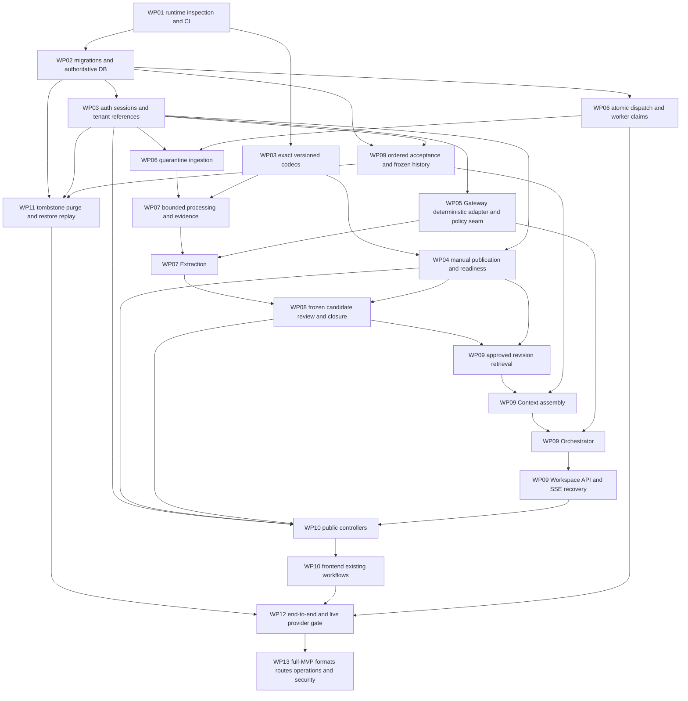

# Implementation dependency graph

Version1.0.0 ·2026-10-21 · reviewed `08ac353f2752c9b368af8c85afd4ebbcace10bfd`. Proposed delivery order, not approval/deployment evidence. [Baseline](IMPLEMENTATION_BASELINE.md), [decision classifications](DECISION_CLOSURE_PLAN.md) and [work packages](MVP_IMPLEMENTATION_BACKLOG.md) are the implementation handoff. Nodes are modules/work, **not independent services**.

Deletion deny predicates and minimized operational logs are implemented at WP03 repositories and every writer **from the beginning**; WP11 completes purge/backup/incident execution, not permission to postpone basic safety. Integration tests accumulate at each node; WP12 composes them, not first tests. Gateway deterministic seam can be built before import; live provider access is a separate gated configuration, not a prerequisite for auth/codecs/manual publication. UI fixture components can be developed before backend integration without asserting connected behavior.

| Node / implementation owner | Prerequisites | Contract/version | Blocking decision at enablement | Migration/configuration | Required proof | Deploy/order |
| --- | --- | --- | --- | --- | --- | --- |
|Runtime/CI / backend+frontend maintainers|Inspect actual apps/AGENTS|Recorded NestJS/Prisma/Next baseline|D-ARCH-01 version/dispatch choice; D-API-07 existing clients|Pin actual toolchains, isolated DB/test secrets|Build, unit runner, schema-validation CI|0 WP01; no data/provider egress|
|DB / Prisma repository layer|Runtime inventory/data inventory|schema.prisma + MVP_CONSTRAINTS.sql|M0–M2 reviews; D-HIST-01/D-KQ-03/D-API-03|Generated Prisma/client + supplements, expand/backfill/quarantine|Actual DDL/integrity/rollback tests on disposable DB|1 WP02; readers before writers|
|Artifact codec / internal shared library|Local schema bundle|2.0 plus selected2.1/2.2/2.5;2.3 definitions|D-AUD-04, D-IMP-LC-01/D-EVID-01/D-HIST-04|No new value table; exact URNs/stage registration|Unknown versions, cross-version refs, lifecycle/type discrimination|0–1 WP03, independently testable|
|Authentication/session / AuthModule|User/AuthSession + issuer/key config|ADR-009/API1.0|D-API-03 signup non-enumeration/CSRF/limits; D-SEC-03|Adaptive hash, fixed session family, cookie/rotation config|Real JWT/refresh/revocation/CORS/Origin tests|2 WP03; seeded test Owner login first|
|Tenant/Brand/reference / Guards+repositories|Session/actual memberships, FK/JSON loaders|Security/provenance + all exact schemas|D-SEC-03/D-REV-01/02 scoped adoption|Single-owner/Org restriction app-transactional; live tombstones|Every direct/nested/read/replay/worker access with second tenant|2 WP03; reused by all nodes|
|Approved snapshots / KM+Brand|Codec/ref/Brand locks|Artifact2.0 + completeness calc2|D-AUD-04/D-KQ-03/D-REV-01|Revision/head/projections atomically; unknown index handling|Manual origin/no Document, head race/rollback/idempotency|3 WP04|
|Knowledge Management review / KM|Snapshots + source/binding validation|2.0 candidate_decision +2.1/2.2|D-AUD-07/D-EVID-02/D-LEARN-02|Stable original item binding; per-item immutable decisions|Approval bypass/forged actor/stale head rejected|6 WP08|
|Queue dispatch / worker role|DB + chosen library|ADR-010/012, library-owned schema|D-ARCH-01|Same-transaction queue adapter or reviewed minimal outbox, fencing/leases|Crash after acceptance/before dispatch, redelivery, stale lease|2 WP06; no new status authority|
|Ingestion / IngestionModule|Session/ref, quarantine and dispatch|Artifact2.0 RAW_INTAKE|D-IMP-01/02/D-SEC-01|Private object/hash, source identity, scan/fetch budgets|MIME/bytes/malware/SSRF/redirect gates|4 WP06; one source, no crawl|
|Document processing / ProcessingModule|Validated retained bytes + scanner|2.0 stages/final;2.2 manifest; evidence1|D-EVID-01/02/D-SEC-01|No extra source DB; immutable representation refs/maps|Actual UTF8/newline/digest/source identity with no parser network|5 WP07; TXT first integration test|
|Source evidence / KM validation+Processing|Real manifests/retained identity|source-evidence1/Artifact2.2|D-AUD-05/D-EVID-01/02|Unique original candidate/manifest resolution under locks|Quote/offset/digest correctness, source removal race|5–6 WP07/08; before eligibility|
|Extraction / ExtractionModule|Structured Document, Gateway seam, field registry|2.0 extraction/Gateway1/evidence1|D-AUD-02/05, D-SEC-02 for live, D-GW-01|Server template/provider allowlist/finite caps|Proposals only, source evidence validation, partial failure not success|5 WP07, no Orchestrator dependency|
|Gateway / Platform GatewayModule|Trusted capability, policy, optional provider secret|Gateway1.0.0|D-AUD-02/D-GW-01/D-SEC-02|One adapter, exact purpose/model/tokenizer/template, quota/fence|Timeout, bad shape, spoofed caller, bounded attempts/no fallback|3 WP05 synthetic; live only after review|
|Import review / KnowledgeImport controller|Frozen eligible set + KM|API1.0/Artifact2.0+2.1|D-IMP-03/D-LEARN-02/D-API-03|No new review table/facade; candidate public mapping|Counts/partial decisions and actual approved head refresh|6 WP08|
|Import closure / application+KM|All frozen decisions and committed publication evidence|import-projection1 +2.1 CLOSED|D-AUD-07/D-IMP-LC-01; optional policies disabled|Brand-lock control chain, derived status only|READY_FOR_REVIEW≠terminal; exactly one closure, crash reconcile|6 WP08; not a provider/queue effect|
|Approved retrieval / Context+KM read facade|Authorized ready approved snapshot|2.0 snapshot; quality missing-state semantics|D-KQ-03; D-KQ-05 numeric ranking off|Bounded direct snapshot selection; no embeddings needed|No candidate/raw source/other tenant; revision pin survives head change|7 WP09|
|Conversation history / Workspace history reader|Order migration, live grants and accepted receipt|history1/Artifact2.5|D-HIST-01–04|Counter/sequence/reply, body/key/pin/catalog under same lock|Timestamp ties, concurrent acceptance, late completion, terminal retry|7 WP09; no long-term Memory Service|
|Context / ContextModule|Approved retrieval + frozen history|2.5 context,2.3 schema refs, history1|D-AUD-01/D-HIST-02, numeric2.4 off|Exact whole-wire tokenizer/policy; selected relationships empty while disabled|Whole-turn suffix, no duplicate USER, untrusted data separation|7 WP09|
|Orchestrator / OrchestratorModule|Context + Gateway + live guards|Final PROMPT/RESPONSE2.0|D-GW-01/D-REV-02/D-API-01|Response/Message final linkage atomic and fenced|Late provider callback cannot overwrite terminal or tombstone|8 WP09|
|Public API / five controller modules|All called module invariants + DTO review|Public1.0, existing46 routes|D-AUD-08/D-API-01/02/03/06/07|Create identity receipt, signed snapshot cursors; no new endpoints|Actual requests/status/alias/schema/idempotency/tenant checks|Controllers grow at WP03/04/08/09, complete WP10/13|
|SSE/recovery / Workspace controller|Durable accepted attempt + generation|Public1.0 SSE/GET recovery|D-API-01/06/D-HIST-03|No event log; retained key/operation read selector|Real fetch/proxy/UTF8/disconnect/deleted/revoked/lost accepted event|8 WP09/10|
|Frontend / existing views|DTO/state bindings; safe mock fixtures earlier|Public1.0 states + Component Kit behavior|D-IMP-03/D-API-04/06|Single-org static label; no speculative screens/tokens|Real keyboard/focus/errors/draft/conflict/recovery/copy/feedback|9 WP10; real UI before pilot|
|Deletion/retention / Workspace+purge worker|Refs/tombstones/purge ownership from first writer|DATA_LIFECYCLE/Prisma purge|D-POL-01/D-SEC-03|Existing independent purge ledger; key/read-cache/queue inventories|E2E16; restricted FK, shared knowledge survival, backup replay|Deny gates2+, full purge9 WP11; before real data|
|Observability/privacy / module outbox+Ops|Committed business IDs, no raw content|Metrics/API telemetry1|D-API-05/D-POL-01/D-ARCH-01|Minimal local operational events; product transport off until selected|No secret/content, dedupe, rollback no success event, consent joins|From WP01; customer analytics gated|
|Integration/security / test harness|Running HTTP/API/worker/browser/DB/object store, approved provider for live|All adopted exact versions|All affected A/B and customer C gates|Disposable seeded two-tenant env, reset/restart controls|E2E01–20 with per-environment evidence; no mocked PASS for live tests|10 WP12/13|

## Cycles and avoidable sequencing

No required module cycle: reference validation reads typed repositories/config only, never calls model/generation. KM does not depend on Context/Workspace; Context reads KM output; Orchestrator consumes Context; Gateway depends on neither caller domain. Extraction→Gateway is not Extraction→Orchestrator→Context→KM. Closure checks committed KM evidence under application coordination, not a callback from a provider to approve facts. UI consumption is downstream of public adapters.

The diagram separates worker transport from business control state; never require queue success before import completion can be defined. Numeric confidence and graph predicate approval are not prerequisites for authorized approved-fact retrieval.2.3 **schema definition loading** is a dependency of2.5 validation;2.3 **writer activation** is not. Gateway seam/codec/frontend mocked work can proceed independently; live provider approval does not block offline migration/auth/manual-publication code. Retention legal sign-off is necessary before real data, but immediate tombstone denial must be coded now. No additional independently deployed service is justified by any dependency arrow.
