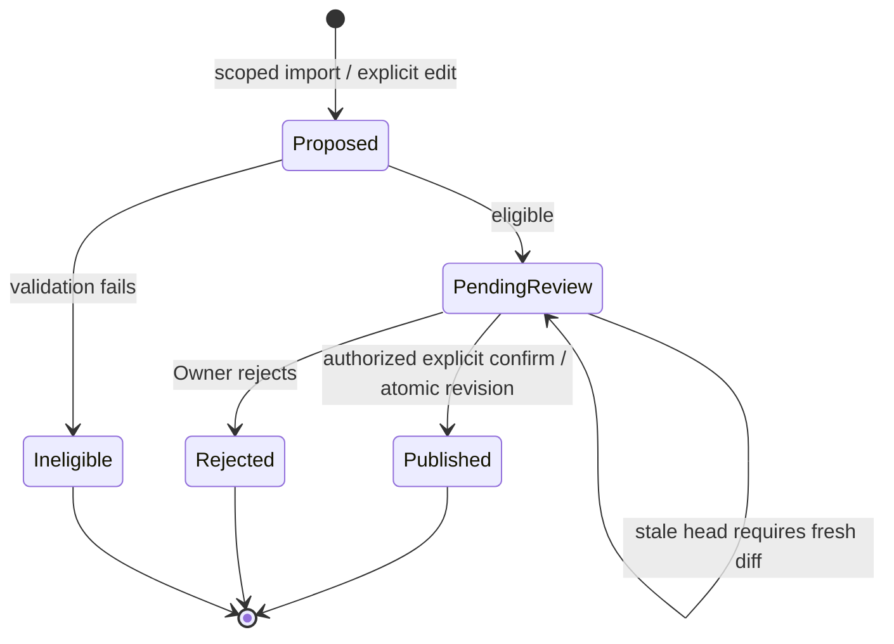

# Approval-based Brand Brain knowledge improvement

Version: 1.0.0. Date: 2026-10-16. Owner: Product + Knowledge Management / Architecture. Status: specified working contract — pending integrated Product/Engineering review; not implementation evidence. Dependencies: [MVP scope](MVP_SCOPE.md), [provenance](KNOWLEDGE_PROVENANCE.md), [security](SECURITY_THREAT_MODEL.md), [metrics](PRODUCT_METRICS.md) and current PRD/import approval gates. No new Founder approval is asserted.

## Product promise and scope

The MVP retains approved business facts and uses approved revisions in future AI requests. Owners can review single-source import candidates and explicitly correct Brand Brain fields. It does not promise that conversation, thumbs-up/down, copying an answer or time spent using AI automatically improves business knowledge or the underlying model. Improvement is a hypothesis to measure, not a guaranteed outcome.

| Input / capability | MVP boundary |
| --- | --- |
| Owner-requested single-source import | Existing extraction generates candidates, subject to existing D-IMP decisions. This is the explicitly scoped automated extraction exception, not continuous autonomous learning. |
| Explicit Brand Brain field correction/manual entry | Owner edits a proposed diff and explicitly saves; validation and confirmation use the existing versioned publication contract. No separate correction-mining feature is added. |
| User interaction or response feedback | Persist permitted conversation/feedback only. No automatic fact candidate, approval or preference inference. Owner may separately enter a correction in Brand Brain; no MVP “save answer as fact” shortcut is implied. |
| Review queue | Logical view of eligible unresolved import candidates in existing review UX. Manual edits use their confirmation form; no required persisted abandoned-edit drafts or new dedicated screen. Placement remains D-IMP-03. |
| Automatic conversation mining, inferred preferences, background stale-fact candidate generation, automatic inference | Later-phase proposal requiring scope, privacy, quality and security review. Any resulting business change would still require explicit human approval. |
| Version inspection and restore | As specified in provenance: inspect diff/evidence and append a newly reviewed revision; no silent pointer rewind or erasure of intervening history. |

## Distinct mechanisms

| Mechanism | Meaning / authority |
| --- | --- |
| Persistent storage | Retains permitted records under retention/access rules. Retaining a conversation does not make its assertions approved facts. |
| Retrieval and contextual reasoning | Selects approved, tenant-scoped facts plus permitted conversation history/working state to answer a request. Reasoning output is not a knowledge mutation. |
| User preference memory | Separate future opt-in personalization, with inspection/correction/deletion rules to be designed. Explicit approved Brand Voice is business knowledge; inferred personal style is not. No hidden preference store in MVP. |
| Verified business-knowledge update | Authorized human reviews evidence and publishes a validated revision. Approval records accountability, not independent proof of factual truth; last verification is explicit, not inferred from use. |
| Model fine-tuning | Changes model parameters through a separately governed training process. Outside MVP. Collecting feedback, retrieving context or changing Brand Brain does not train/fine-tune a model. No training dataset or consent is inferred. |

There is no standalone Memory Engine service specification in this repository. [Context Engine Stage 7](services/05_CONTEXT_ENGINE.md#stage-7--memory-selection) defines memory selection; [AI Memory Bible](BIBLE/05_AI_MEMORY_BIBLE.md) is project continuity documentation, not an implemented customer-memory engine. New memory services require their own approved contract; they cannot become an alternate business source of truth.

## Lifecycle and concurrency

1. **Propose:** import extraction emits immutable KNOWLEDGE_CANDIDATE artifacts. Explicit manual corrections create a proposed field diff in the existing form; saving is explicit review/approval, not inferred interaction learning. Later automatic interaction candidates are disabled in MVP.
2. **Describe:** identify candidate/fact key, entity/field, proposed value/removal, source/evidence and available location, origin, extraction confidence or null for manual input, validation/conflict/staleness indicators, and base approved revision. Confidence is a model/policy indicator, never a calibrated probability of truth unless separately validated. Missing evidence is visible, not fabricated.
3. **Queue:** deterministic governance admits eligible proposals to a tenant/Brand-scoped logical review view. Ineligible extraction does not become approved or user-reviewable; safe aggregate “no usable match” feedback preserves the Import PRD. Candidates conflicting with approved values show both values and evidence. Queue items are not approved knowledge.
4. **Decide:** sole authorized Owner can confirm, edit-and-confirm, or reject/dismiss. Editing revalidates value/provenance and preserves original proposal. Proposed import value deleted in review means rejection of that proposal, not deletion of an approved fact. Manual field removal is a distinct explicit versioned mutation. Reject leaves approved head unchanged. An unfinished manual edit can be discarded without a persistent candidate record.
5. **Publish:** Knowledge Management checks current authorization, evidence, expected head, ontology, idempotency and field restrictions under Brand lock. A valid confirm/edit creates one full approved snapshot and BrandBrainRevision, recomputes completeness/readiness, updates projections/index and advances currentRevisionId atomically. Record actor/time/reason, decision and resulting revision. Rejected import decisions append audit artifacts only. No extraction worker can approve.
6. **Apply:** each new generation pins the current approved revision when preparing context. An already pinned in-flight attempt may finish on its earlier revision; identify that revision in operational artifacts and never mix revisions. Subsequent requests resolve the new head; invalidate scoped caches/index projections transactionally or fail closed until consistent. Authorization/deletion/security gates still apply.
7. **Inspect / reverse:** show field history, old/new values, evidence, introducing/verification revision, approver/time and reason. Restore preview revalidates current ontology/evidence and produces a diff; authorized confirmation appends a revision with restoredFromRevisionId. Rejection and unapproved proposals cannot be restored as approved history.

These are semantic review outcomes, not ArtifactStatus, MessageStatus or new Prisma enums. No bulk auto-accept, delegated reviewer or automatic decision from ratings is authorized. Exact whole-import terminal-state aggregation and active-job admission remain R23 / D-IMP-02; this fact-level lifecycle does not claim to settle them.

## Minimum persistence contract — reuse, no new Prisma entities

Use [Artifact candidate/decision variants](domain/02_ARTIFACT_MODEL.md#3-knowledge-candidate-artifact), BrandBrainRevision, Brand.currentRevisionId and existing source Document/Artifact relations. Business values live only in approved snapshots, with transactional projections; feedback remains linked to Message, never approval. No separate mutable learning table, preference store or training dataset is needed. Schema remains unchanged because JSON candidate/decision payloads already support the required extension. These payload contracts require implementation/migration review even without DDL.

| Record | Required fields / invariants |
| --- | --- |
| Candidate payload (versioned variant) | brandId validated against Artifact.organizationId; stable candidateId within artifact; stable fact key `(entityType, entityId, fieldPath)`; operation set/remove; proposed value; baseRevisionId (null only before first approval); trigger IMPORT or EXPLICIT_CORRECTION; origin; evidence links/locations or manual author; confidence value/basis or null; affected keys; competing approved value revision and contradiction/staleness flags; createdAt. New entities use stable provisional IDs that map once during publication. Manual forms need not persist drafts; an approved save records its proposed diff in the commit/decision artifact. |
| Immutable candidate_decision / commit payload | candidate artifact/item reference when present; manual diff otherwise; action CONFIRM / EDIT_AND_CONFIRM / REJECT; original proposal plus edited diff references; reason (manual correction/restore rationale required, optional reject comment); actorId, server timestamp; expectedRevisionId; operation/idempotency key and request hash; resultingRevisionId only for publication. Same-tenant/type/reference validation and serialized uniqueness checks required. |
| Approved state | Existing immutable full snapshot plus revision approval/provenance/completeness metadata. Link decision to revision rather than duplicating approval state on business tables. No inferred lastVerifiedAt from feedback. |
| Measurement records | Minimal structured operational events with tenant/Brand, operation/candidate/fact-key identifiers, trigger, event time and revision IDs; no source text in analytics. Factual review labels and regression results are controlled evaluation records, not runtime business values or an unapproved production training store. |

Review status is derived from eligible candidate items and their terminal decision artifacts. Ordinary edit is transient until edit-and-confirm; there is at most one terminal decision per item, serialized under the Brand lock. Repeated operation keys replay the same result; competing keys for an already decided item return 409. Rebase against a changed head must show a fresh diff and require renewed confirmation, never silently approve. Query by existing Organization/type/correlation and JSON payload index, with bounded cursor pagination; a future measured need may justify a projection, never a second authoritative decision store. Retention of candidates/decision records must preserve approved evidence and minimal audit requirements under the independently approved policy; do not force retained conversation IDs as permanent provenance.

## Planned API contract

Existing public routes and provenance contracts remain primary. Read operations are authorized; mutation additionally checks current Owner and CSRF/session protections. 404 conceals foreign/unknown IDs; 409 covers stale head, prior terminal decision or idempotency mismatch; 422 covers invalid fields/evidence; 403 may describe a known authenticated principal lacking an allowed operation without disclosing another tenant's object.

| Operation | Contract |
| --- | --- |
| GET `/brands/:id/knowledge-change-candidates` | Proposed read facade over existing import review, not a new screen: optional state/trigger filter, cursor and limit ≤100. Returns item identity, diff, confidence basis, sources, flags, base/current revision and allowed actions. Never returns foreign or ineligible content. No implicit candidate creation. |
| Existing import candidate PATCH | Existing confirm/edit/delete route maps to CONFIRM/EDIT_AND_CONFIRM/REJECT. Include expectedRevisionId, Idempotency-Key, item identity and optional changed value; return terminal outcome and resultingRevisionId for approval. No second conflicting decision endpoint. |
| Existing Brand Brain PATCH | Existing explicit manual save/removal, with expectedRevisionId, Idempotency-Key and correction reason. Returns newRevisionId and readiness; pending unsaved values do not enter retrieval. |
| Existing knowledge/history/diff/verify/restore routes | Use [provenance API contracts](KNOWLEDGE_PROVENANCE.md#api-contracts-ownertenant-scoped-planned). Restore uses preview digest and explicit confirmation; verification is an explicit metadata-only revision. |
| Existing message feedback POST | Rating only; existing one-response feedback uniqueness applies. Returns feedback receipt, no candidate/revision/training claim. Later interaction-derived candidates require a separate approved API and data-use design. |

The candidate read facade is a specified integration contract pending Product/Engineering review, not an already approved new surface. UI placement and exact import terminal resolver remain open. The existing candidate binding is PATCH `/brands/:id/import-jobs/:correlationId/candidates/:candidateId` in API Design. Its extended payload/schema version and aggregate import outcomes still require integrated review; do not invent a second route family.

## Measurement contract — goals to define, no observed results

Measure separate import and explicit-correction cohorts; do not pool them or count ratings as corrections. Use UTC server events and deduplicated operation/item IDs. Default reporting period is a calendar month; operational follow-up is a proposed 30-day window. Numerical performance targets, review sample sizes and stale-age thresholds require Product/Engineering approval (D-LEARN-01). Publish sample size, coverage, exclusions, pending counts and interval uncertainty alongside rates; insufficient samples mean “insufficient evidence,” never 100% accuracy.

| Metric | Definition and denominator | Limits / safeguards |
| --- | --- | --- |
| Correction acceptance | For explicit correction proposals receiving a terminal review decision in period: published unchanged / all decided corrections; separately published after edit / all decided and rejected / all decided. Total adoption = both published categories / all decided. Deduplicate retries; link edit to original proposal. | Unpersisted abandoned manual edits are unobservable and excluded explicitly. Current direct-save flow often has only approved commits, so its acceptance rate is selection-biased and must not be marketed as reviewer acceptance. Report import rates separately and pending/age at period end; if rejection coverage absent report approved count, not a misleading rate. |
| Factual accuracy | On a documented, stratified sample of generated factual claims, correct / independently adjudicable sampled claims. Reviewer compares with dated authoritative evidence, recording correct/incorrect/unverifiable. Report unverifiable fraction of all sampled claims plus approved-snapshot consistency separately. | Model self-grading, helpful ratings and agreement with an approved but false fact do not establish truth. Use blinded human/evidence-based adjudication and disagreement resolution, track ontology/model/prompt/revision and sampling exclusions. No regulator/certification implication. |
| Stale knowledge | Stale-or-never-verified material facts / all current material facts requiring periodic verification, as of timestamp. Stale if last explicit verification exceeds field-specific approved age threshold; never-verified reported separately. Also report overdue review count/age. | Threshold policy version required; if undefined report age distribution and unknown coverage, not a stale percentage. Completeness and readiness remain separate; staleness warnings do not silently change score or facts. |
| Repeated-error reduction | Paired fixed test questions tied to a corrected fact: pre-approval error rate minus post-approval error rate in percentage points; relative reduction = difference / pre-rate only if pre-rate >0. Same scored claims/questions, model/prompt/settings and blinded rubric; pin old vs new revision. Record repeated-run variance and time window. | If pre-rate=0 relative reduction is undefined. Report regressions, unrelated control questions and number of pairs. Changes in live user mix/provider cannot establish causality; report observational recurrence separately as recurring adjudicated errors / evaluated opportunities for that fact. |

Required events: CandidateCreated, CandidateEligible/CandidateIneligible, CandidateDecisionRecorded (action/edit flag), KnowledgeRevisionPublished, GenerationContextPinned, KnowledgeVerificationRecorded, EvaluationClaimAdjudicated and CorrectionRegressionEvaluated. Events include policy/schema/evaluation version, event/operation ID and time; successful decisions/publication use transactional outbox or recoverable commit-artifact derivation to avoid counting rolled-back work. Events are proposed instrumentation, not existing telemetry. Retention/access/privacy require the existing policy reviews. Helpful/not-helpful may support product analysis, not these factual metrics or model-training claims.

## Acceptance scenarios — specifications, not executed tests

| ID | Scenario / expected result |
| --- | --- |
| KL-AT-01 | A helpful rating, copied answer or repeated conversation claim stores only permitted interaction data; no candidate, preference update, revision or training operation follows. |
| KL-AT-02 | Import proposes a conflicting price with evidence/confidence; review shows old/new values; generation remains on approved price until explicit confirmation. |
| KL-AT-03 | Reject or discard edit leaves head/index/completeness unchanged; rejecting a candidate does not delete the approved field. |
| KL-AT-04 | Edit-and-confirm preserves original proposal and edited diff, revalidates, creates one revision and audit reason; retries do not duplicate it. |
| KL-AT-05 | Two reviewers/operations race or head changes; one valid publication wins and stale review receives 409/fresh diff, never silent rebase. MVP permissions remain sole Owner. |
| KL-AT-06 | Candidate spoofed tenant/evidence/approval metadata, revoked Owner or extraction service attempts publication; denied server-side without data disclosure. |
| KL-AT-07 | New request pins new approved head; previously running request identifies its old pinned revision; stale caches/index cannot mix heads. |
| KL-AT-08 | History explains change; restore preview and confirmation append a revision preserving intervening history; invalid evidence/ontology blocks restore. |
| KL-AT-09 | Never-verified fact, undefined stale threshold or no evaluated claims yields explicit unknown/insufficient evidence; no fabricated metric. Completeness 100 does not prove accuracy or freshness. |
| KL-AT-10 | 10 decided correction proposals: 4 unchanged approvals, 2 edited approvals, 4 rejections → 40%, 20%, 40%, total adoption 60%; pending/abandoned reported outside denominator. |
| KL-AT-11 | 20 sampled claims: 12 correct, 3 incorrect, 5 unverifiable → accuracy 12/15=80%, unverifiable 5/20=25%; show evidence/coverage, not 100% based on helpful ratings. |
| KL-AT-12 | Of 10 verification-required facts, 2 overdue and 3 never verified → stale-or-never-verified 50%, components 20%/30%, under a recorded threshold policy. |
| KL-AT-13 | Matched regression error rates 40%→10% → 30 percentage-point reduction and 75% relative reduction; pre-rate zero yields undefined relative reduction; negative changes reported as regressions. |
| KL-AT-14 | Conversation deletion purges associated feedback/operational data without erasing independently approved facts; no new durable provenance points to purged message payloads. |

## Review and migration requirements

No Prisma DDL is required. Before enabling the read facade or extended metrics, version candidate/decision JSON schemas, validate existing artifacts without manufacturing absent decisions/evidence/confidence, and label legacy missing fields unknown. Backfill only mechanically derivable references; re-review if interpretation is needed. Preserve historical immutable artifacts using adapters or append-only migration records; validate tenant/reference gateways, idempotency and bounded derived review queries. Deploy readers compatible with old payloads before new writers; rollback disables new writers/facade and retains published revisions. Required runtime tests above and security/provenance release gates remain pending. Formal import UI/concurrency and full import terminal resolver are not silently resolved by this document.
