# Knowledge ingestion and AI context security threat model

Version: 1.0.0. Date: 2026-10-16. Owner: Engineering / Security, with Product and Operations review. Delivery: specified, implementation unverified. Dependencies: provenance, data lifecycle, auth ADR and D-SEC-01/02/03. Approval evidence: not recorded. Status: specified launch requirements — pending security review and implementation evidence. No control below is claimed implemented, independently assessed or certified. This file is at the documentation repository root (`docs/SECURITY_THREAT_MODEL.md` in the project).

## Scope, assets and trust boundaries

Scope: [Ingestion](services/01_INGESTION_SERVICE.md) → [Document Processing](services/02_DOCUMENT_PROCESSING_SERVICE.md) → [Extraction](services/03_KNOWLEDGE_EXTRACTION_SERVICE.md) → [Knowledge Management](services/04_KNOWLEDGE_MANAGEMENT_SERVICE.md) → [Context Engine](services/05_CONTEXT_ENGINE.md) → [Orchestrator](services/06_AI_ORCHESTRATOR.md) → [Workspace](prd/02_AI_WORKSPACE_PRD.md). Assets include source files, approved facts, evidence, tenant identifiers, credentials, prompts/responses, audit records and backups. Attackers include malicious source publishers, compromised or malicious Owners, unauthenticated upload/fetch callers and compromised dependencies/providers. A valid Owner can submit hostile content; authentication does not make it trusted.

Boundaries: browser/API; fetcher/public Internet/private infrastructure; quarantine/parser; parser/external model; candidate/approved storage; tenant-scoped retrieval; provider/response renderer; operators/storage/backups. Workers and external providers are distinct principals. Tenant IDs and source attribution from request bodies, URLs, files or model output are untrusted. The MVP remains one Owner/Organization/Brand per account; shared infrastructure still requires tenant isolation.

```mermaid
flowchart LR
    U[Authorized Owner] --> I[Intake and quarantined source]
    W[Untrusted website or file] --> I
    I --> F[Restricted fetcher and isolated parser]
    F --> E[Extraction: untrusted candidates]
    E --> H[Explicit human review]
    H --> K[Authorized atomic publication]
    K --> A[Approved revision and scoped index]
    A --> C[Context Engine: data only]
    C --> O[Workspace Orchestrator]
    O --> G[Shared Gateway: policy, tenant, budgets]
    E --> G
    G --> P[Reviewed adapter and external provider boundary]
    P --> R[Untrusted response: safe rendering]
```

## Mandatory invariants

- SEC-01: Imported documents, websites, source metadata, prior responses and retrieved knowledge are data, never execution or policy authority. Even human-approved business facts cannot override system policy, tenant scope, tool permissions or approval rules.
- SEC-02: Every knowledge mutation, including manual edits, imports, approvals, restore, projection/index writes and background retries, requires server-side authorization. Workers use narrowly scoped service identities tied to an authorized tenant/job; extraction identities cannot publish approved knowledge.
- SEC-03: Candidates remain logically separate from approved revisions. Only explicit authorized human approval can advance `Brand.currentRevisionId`; confidence, trust score, extraction success, automated validation and completeness never constitute approval.
- SEC-04: Retrieval, artifact/object access, source previews, caches, polling, streaming and callbacks enforce Organization/Brand ownership and lifecycle checks. An object UUID or signed URL is not sufficient tenant authorization.
- SEC-05: URL destinations are validated before connection and at every redirect; DNS answers must be bound to the actual connection. Parser/LLM output cannot initiate arbitrary network access.
- SEC-06: Secrets and unnecessary sensitive data stay outside model context and logs. Allowed provider disclosure is explicit and minimized; external processing is a real trust boundary, not a promise that prompts never leave the platform.

## Threat register and acceptance scenarios

All preventive and detection controls in this table are **required before launch** for the enabled path. Tests are acceptance specifications, not executed results. Optional enhancements appear separately below. Owners must record evidence for each test ID before release.

| ID / threat and owner | Preventive controls | Detection controls | Residual risk | Required acceptance scenarios |
| --- | --- | --- | --- | --- |
| SEC-T01 Prompt injection — Extraction, Context, Orchestrator | Separate application instructions from labeled/structured source data; never interpolate source content into system roles. No model-controlled tools, credential access, fetch execution or automatic approval. Parse output against bounded schemas and reject unknown mutation fields. Model output is untrusted. Human review does not promote embedded instructions to authority. | Version prompts; record content-free policy/schema rejection codes; maintain hostile-document regression corpus and review suspicious candidate instructions. Filtering/classifiers are supplementary, not security boundaries. | Models can still obey indirect or obfuscated instructions and produce misleading prose; review may miss them. | SEC-AT-01: HTML/PDF/text containing “ignore instructions”, forged system delimiters, encoded instructions and exfiltration links cannot approve a fact, call a tool, change tenant or read secrets. Repeat after human approval of surrounding business facts. Verify candidate review remains required and suspicious output is safely rendered. |
| SEC-T02 SSRF / rebinding / redirects — Ingestion fetch boundary, Operations | Apply restricted fetch contract below; no direct fetch elsewhere; network egress blocks private/metadata destinations independently of application checks. No browser-script execution, recursive crawl or external subresource loading. | Log sanitized destination classification, redirect count and denial reason; alert on repeated private/metadata probes and egress-policy denials. Do not log URL credentials or sensitive queries. | Public hosts may proxy internal content or change content; address-classification libraries and network rules can have defects. | SEC-AT-02: deny localhost, RFC1918, link-local/cloud metadata, IPv6 loopback/ULA, mapped IPv4, alternative numeric IP forms, userinfo tricks, mixed public/private DNS answers and public→private redirects. Simulate DNS changing between validation and connect, reconnect and redirect; no connection reaches a prohibited address. |
| SEC-T03 Malicious/oversized files and parsers — Ingestion, Processing | Quarantine; inspect extension, MIME and signature together; no public executable storage. Malware scan before parsing; scanner unavailable means queued/rejected, never bypassed. Sandboxed non-root parser, no network/credentials, read-only runtime, isolated bounded scratch space; disable PDF scripts, macros, XML external entities and DOCX external relationships. Bound decompression, pages, text, CPU, memory and duration. | Scan results, parser timeouts/crashes, quota hits and cleanup failures produce content-free alerts; track dependency advisories and security patch ownership. | Scanners miss novel malware and parsers may have zero-days. | SEC-AT-03: spoofed MIME, polyglot, EICAR test fixture, encrypted/unsupported file, ZIP bomb/DOCX expansion, XXE/external references, path traversal names and oversized streamed bodies remain quarantined/rejected; parser cannot read host secrets or fetch URLs; timeout kills worker and removes bounded scratch data. |
| SEC-T04 Cross-tenant leakage — all services | Derive tenant from authenticated ownership; scope queries before vector search/ranking and revalidate every retrieved result. Include tenant, Brand, approved revision and lifecycle in cache keys. Tenant-bound object access, queues and SSE subscription checks. Protected reads use an authorization gateway that rechecks tombstones; direct presigned reads that remain usable after deletion are prohibited. Signed URLs alone cannot provide immediate revocation. No global semantic dedup revealing existence across tenants. | Tenant-mismatch denial/audit events, synthetic tenant canaries and isolation tests; security alert on a mismatched retrieval result even when blocked. | Privileged infrastructure access, query bugs and shared provider compromise remain threats. | SEC-AT-04: Owner A guesses B’s artifact/document/job/revision/conversation IDs through API, preview, polling, restore, retrieval and SSE; no content or existence disclosure. Duplicate source and identical prompt across tenants cannot reuse B’s data/cache. Forged queue/callback tenant is rejected. |
| SEC-T05 Unauthorized mutations / approval bypass — Knowledge Management | Recheck current Owner membership, Brand ownership, candidate/evidence ownership and expected head revision inside publication transaction. Validate allowed fields and provenance; never trust client approval metadata. Atomic snapshot/head/projection update; stale head returns conflict. Idempotency scoped to tenant/action; CSRF/session protections apply. Restore appends a reviewed revision. | Audit actor/service identity, action, object/revision IDs, result, correlation and timestamp; alert on denied publication, replay and stale-head spikes. | Compromised Owner/session can intentionally approve harmful facts; authorization does not prove truth. | SEC-AT-05: forged approver/time/status, high-confidence extraction, revoked session, extraction worker credentials, concurrent approvals, replayed approval and cross-tenant evidence cannot publish without valid approval; rollback leaves prior head and index consistent. Restore requires authorization and creates history rather than rewinding it. |
| SEC-T06 Sensitive prompts/responses/logs/provider exposure — Context, Orchestrator, Workspace, Operations | Apply minimization/provider contract below; never send auth tokens, API keys or unrelated tenant facts. Redact sensitive error payloads. Escape/sanitize rendered Markdown/HTML, block remote image loads and unsafe link schemes; no automatic URL previews/fetching from model output. | Canary-secret tests, content-free provider usage/denial telemetry and access reviews; bounded secret/PII screening before egress/stream display as an additional control, with safe failure behavior. | Detectors miss sensitive facts; authorized business content can be disclosed to the selected provider and model output can repeat it. | SEC-AT-06: seeded tokens and unrelated tenant facts absent from provider request/logs; fake provider errors do not expose prompts/keys. Script/HTML/javascript links and tracking images cannot execute/load. A blocked response fragment is not streamed first. Provider outage/retry does not route data to an unapproved fallback. |
| SEC-T07 Retrieval poisoning / forged attribution — Knowledge Management, Context | Only current approved tenant-scoped revisions feed generation; verify source IDs/locations against stored evidence, not model-supplied URLs. Preserve immutable evidence hashes, fetch time and source identity. Clearly distinguish “source says” from verified fact; confidence is not reliability. Contradictory/stale candidates require review; invalidate stale indexes/cache on publication. | Detect missing/mismatched evidence, index/head divergence, contradictions and age thresholds; surface review warnings with source excerpts and revision diff. | A convincingly false source or malicious authorized approval can poison approved knowledge; citations do not prove factual accuracy. | SEC-AT-07: an unapproved candidate, superseded revision, forged citation, altered object or stale index cannot enter generation context. Conflicting import leaves approved head unchanged; reviewer sees competing values/evidence. Missing locations are labeled unavailable, never fabricated. |
| SEC-T08 Storage/access/audit/retention compromise — Operations, Engineering | TLS for internal/external links; managed encryption at rest for database, objects, scratch, logs and backups; separated key access/rotation and least-privilege DB/storage identities. No public buckets. Lifecycle-aware object access, expiring signed URLs, append-only ordinary audit writes and restricted administrative access. Apply lifecycle/backup contract below. | Audit privileged reads, key/storage policy changes, purge failures and overdue jobs; alert on tampering and failed restore replay. Test restore and revocation, not only backup creation. | Privileged/key compromise, immutable backup lag and authorized retention exceptions prevent instant erasure; append-only application behavior is not cryptographic immutability. | SEC-AT-08: anonymous object read and expired/mismatched signed URL denied; privileged access audited without content. Deleted conversations denied immediately; purge respects shared knowledge and retries safely; backup restore reapplies tombstones before serving. Failed cleanup alerts and retains pending state, never marks false completion. |

## Restricted URL-fetch contract

Ingestion owns admission and the policy for a dedicated fetch adapter; Document Processing consumes its validated bytes and cannot fetch arbitrary links. This boundary does not move parsing or extraction into Ingestion. Accept only normalized absolute HTTP/HTTPS URLs, no userinfo, fragments as fetch targets, custom schemes or arbitrary ports. Proposed initial port policy: 80/443 matching scheme, with HTTPS preferred; Security must approve deployed values. Validate host syntax using a maintained URL/IP library; reject ambiguous host encodings and non-public literal addresses. Resolve all A/AAAA/CNAME outcomes and reject any prohibited address, including reserved/non-global, loopback, private, link-local, multicast and metadata endpoints. A DNS name check alone is insufficient.

Disable automatic redirects. For each bounded redirect, parse the new absolute destination, repeat full scheme/port/DNS checks, then connect only to an approved resolved address with correct Host/SNI and TLS verification. Recheck actual peer address; enforce the same validation for retries/new connections and prevent uncontrolled proxy resolution. Reject HTTPS downgrade, redirect loops and credential/header forwarding across origins. If the networking client cannot preserve validated-address binding, fail closed. No cookies, user credentials, ambient proxy credentials or internal headers are forwarded. Return bounded bytes, not an open connection for downstream code.

Enforce configurable finite redirect count, DNS/connect/read/overall timeout, compressed and decompressed byte limits, response content types and per-tenant/global rate/concurrency quotas. Reject as soon as streamed limits are reached; HEAD/Content-Length alone cannot enforce size. No JavaScript, third-party assets, recursive pages or PDF/DOCX referenced resources are fetched. Operations must verify network-level egress policy with rebinding tests. Proposed numeric budgets must be recorded and load/security-tested before URL import is enabled; no arbitrary unlimited default is permitted.

## Upload, quarantine and provider contracts

Upload credentials are short-lived, scoped to an authorized tenant/job/object key and write-only where supported. Server generates keys; client filenames are metadata, never paths. Enforce actual object size and content checks after transfer even if UI validation passes. Object completion cannot release quarantine until scan/type/limits succeed; signed upload expiry is not proof of scan. Reject password-protected or unsupported formats safely. Ordinary users cannot serve raw quarantined content inline; any authorized preview uses inert text or isolated safe rendering. Scanner choice, parser versions and concrete size/page/decompression/time budgets are launch-blocking Engineering/Security decisions. If scanning is unavailable at launch, file import stays disabled; URL text intake still requires parser isolation and fetch controls.

Extraction and generation may send necessary business content to an explicitly reviewed external provider. Before enabling either path, document provider/subprocessors, permitted data categories, processing region, retention/deletion behavior, training-use configuration/terms, credentials, retry/fallback policy and user disclosure. Legal/privacy and Security review this inventory; unknown behavior blocks that provider path. Do not promise zero retention, no training, residency or regulatory compliance without evidence. Users should avoid importing credentials or unnecessary sensitive personal information; warnings alone do not replace server controls. Embedding, classification and scanning providers are subject to the same review, not just chat models.

Send minimum relevant approved fields for generation; extraction necessarily sees unapproved source text in a segregated prompt, never the generation retrieval index. Conversation history is tenant-scoped and still untrusted instruction data. Keep source data distinct from system policy and avoid whole raw sources when bounded relevant excerpts suffice. Prompts/responses stored as operational artifacts have the same authorization and retention safeguards as business content. Logs/metrics contain IDs, timings, reason codes and counts by default, not prompts, document text, full URLs, signed links or provider bodies. Debug content capture is off by default and requires documented necessity, restricted access, expiry and data-owner/privacy review. Streaming enforces available secret/output checks before releasing each fragment, then final validation; if a required check cannot safely stream, buffer the response. This reduces exposure, not guarantees perfect PII detection.

## Persistence, authorization and lifecycle

Use the [authentication/authorization ADR](domain/08_BACKEND_AUTH_AND_CONSTRAINTS_ADR.md), [provenance contract](KNOWLEDGE_PROVENANCE.md), [schema](schema.prisma) and [data lifecycle](DATA_LIFECYCLE.md). Prisma relations and UUIDs do not by themselves enforce tenant isolation or human approval. No new parallel approval store is introduced: immutable approved Artifact snapshots, BrandBrainRevision metadata, Brand.currentRevisionId and validated projections remain the sources of truth. Candidate artifacts are excluded by policy, query predicates and role permissions; access to raw/candidate material for review is distinct from eligibility for generation. Validate same-tenant references on every write/read; raw SQL, jobs, admin tools and restore operations cannot bypass these rules.

Audit records capture actor, action, tenant/object/revision references, outcome and policy version, with minimal content. Ordinary writers cannot alter history; privileged corrections are new records. Retention is bounded and separately approved, not “immutable forever.” Evidence integrity uses persisted content digests and controlled object writes; a hash proves consistency with captured bytes, not publisher honesty.

Conversation deletion immediately blocks reads, retrieval, streams and late callbacks. Proposed active removal within 30 days and separate backup expiration remain pending legal/operational approval; do not represent pending deletion as erasure. Source/quarantine/scratch, embedding/index/cache, operational memory, provider copies and any future exports need explicit inventory and cleanup ownership. Preserve imported/shared approved facts when their provenance is independently retained; delete only conversation-owned references/data under reference-aware rules. Legal holds, minimal audit metadata, purge failures/retries and backup restoration follow DATA_LIFECYCLE.md. Define raw-import/quarantine/audit retention schedules before launch; conversation targets do not silently determine all other retention classes.

## Launch gates, later improvements and decision ownership

Launch requires SEC-01–06, all enabled-path threat controls and SEC-AT-01–08 evidence; authenticated service identities, locked-down storage/network policy, bounded parser/fetch/provider budgets, incident owner, alert routing and tested disable switches for imports/provider calls. Engineering owns implementation/test evidence; Security reviews threat/control coverage; Operations owns egress, secrets, monitoring and restore/purge readiness; Product/Legal/privacy own disclosure and policy decisions. Record exact application revision, environment, cases/results, residual risks and approving roles. No passing evidence is recorded here. A disabled path must be enforced server-side and reflected in launch scope; disabling a canonical MVP capability requires Product/Founder scope review, not an undisclosed security waiver.

Optional later improvements: PostgreSQL row-level security as defense in depth (application scoping is mandatory now), dedicated per-tenant keys/infrastructure, automated source reputation, content-disarm/reconstruction beyond mandatory scanner/isolation, continuous adversarial fuzzing, richer injection classifiers, external penetration assessment and cryptographically chained audits. These cannot substitute for launch controls. If assessed deployment risk requires one, explicitly promote it to a launch gate through review.

Pending decisions are registered as D-SEC-01: concrete operational limits and scanner/parser choices; D-SEC-02: approved providers/data handling and disclosure; D-SEC-03: storage/key/access, audit/quarantine schedules and release evidence. No formal sign-off is inferred from this task. Known residual risks require explicit release review; unresolved foundational controls block the affected path.

## Reference basis

Control design draws on [OWASP SSRF Prevention](https://cheatsheetseries.owasp.org/cheatsheets/Server_Side_Request_Forgery_Prevention_Cheat_Sheet.html), [OWASP File Upload](https://cheatsheetseries.owasp.org/cheatsheets/File_Upload_Cheat_Sheet.html) and [OWASP LLM Prompt Injection Prevention](https://cheatsheetseries.owasp.org/cheatsheets/LLM_Prompt_Injection_Prevention_Cheat_Sheet.html). They support destination binding, layered upload defenses and separation of untrusted content from instructions; this project’s launch gates and choices above are proposed engineering requirements, not OWASP certification.

## Task17 — Shared invocation enforcement boundary

[ADR-011](domain/10_AI_PROVIDER_GATEWAY_ADR.md) and [Gateway contracts](contracts/ai-provider/README.md) consolidate SEC-T01/04/05/06/07 for both extraction and generation. Authenticate internal callers with an opaque application/worker capability and current tenant/Owner grant; JSON caller IDs are not credentials. Only Gateway-owned adapters hold server secrets/contact providers; Gateway cannot retrieve or mutate approved knowledge. Separate server-loaded reviewed template references from untrusted task data; no model-directed tools, fetches, provider/tenant/policy changes or approval. Enforce minimized permitted data categories, local output schema/byte limits, safe error/telemetry allowlists, finite total attempt/token/time/cost reservations and per-tenant/purpose fairness. Recheck auth/cancel/tombstones/lease after await and before publication; discard late output, account possible charges.

MVP supports one reviewed provider and prohibits alternate provider, region, model or cross-tenant credential fallback. D-SEC-02 remains **Proposed — Pending Approval** for actual vendor/subprocessors/region/retention/training settings and disclosure. D-GW-01 leaves numeric limits, uncertainty, deduplication and telemetry retention pending. AT-17-01–17 are executable offline fixtures, not real egress, injection-resistance, distributed-isolation, privacy or cancellation evidence. Required controls and actual enabled-path integration results remain launch gates; no compliance certification is claimed.

## Task18 — Import control and review security

[ADR-012](domain/11_IMPORT_LIFECYCLE_ADR.md) specifies Owner-scoped polling/candidate reads, immutable human decisions, expected-head conflicts, Brand-locked admission/publication/closure and current worker fencing. Validate tenant/source/control references and authorization again before every durable write; authorize before ETag/replay so stale caches cannot bypass revocation. Proposed Artifact2.1 controls grant no knowledge approval rights and contain no business fact copies. Required lifecycle revocation permits narrowly scoped content-free closure bookkeeping, never late approval. Closure is absorbing; stale workers cannot reopen it. New bulk discard/expiry/forced-cancel behavior stays D-IMP-LC-02 pending; source/control retention remains D-POL-01. Offline AT-18 and isolated PostgreSQL mechanisms are not real authorization/queue/security evidence.

## Task19 — Evidence integrity and authorized excerpts

[ADR-013](domain/12_SOURCE_EVIDENCE_MAPPING_ADR.md) and [typed evidence contracts](contracts/source-evidence/README.md) require exact tenant/source/candidate references, retained-byte digests, coordinate/unit/quote/map/parser validation before review eligibility and publication. Imported source/model citations remain untrusted. Verify against captured bytes/text only, never arbitrary URL refetch; Ingestion retains SEC-T02 redirect/DNS controls, parsers stay isolated. Inert HTML anchors do not guarantee browser visibility; scripts/hidden/uncertain content is excluded or flagged. No OCR/monitoring/new provider path. Source/quote reads reauthorize, sanitize and handle bidi; logs omit raw text/full URLs/secrets/public digest correlation. D-SEC-01 actual parser/capture/limits and D-POL-01 retention remain open. D-EVID-01/02 add version/policy reviews; synthetic map/anchor tests are not real parser/SSRF/storage/security evidence.

## Task20 — Relationship persistence and lifecycle

**Specified — Pending Architecture/Product Review (D-AUD-06).** [ADR-014](domain/13_ONTOLOGY_RELATIONSHIP_PERSISTENCE_ADR.md) and [canonical registry/contracts](contracts/ontology-relations/README.md) define the versioned mapping.

SEC-REL-01 (launch requirement if proposed relationship writer is enabled): schema validation is insufficient. Reauthorize Owner, validate tenant/Brand on typed retained endpoints, approved snapshot, approval decision and source binding; reject reserved/dangling/unknown/direction/version mismatches. Body/model-supplied actor/gate flags are untrusted. A real service must load policy and identities from trusted server state; offline test fixtures simulate that state only. Retrieval pins one revision, bounds expansion and excludes pending, archived/deleted/stale-support edges. Replay authorization precedes receipt lookup; unknown/orphan caches never create knowledge. Source bytes remain data, not approval authority. AT-20-08–16/19/23/26–29 are offline scenarios; real authorization, concurrency and erasure tests remain launch dependencies.
