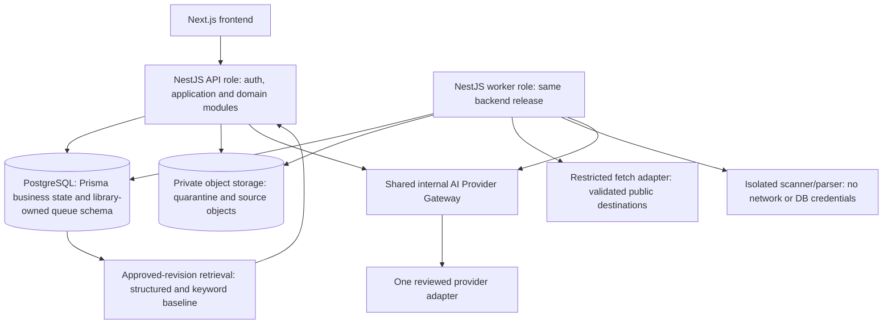
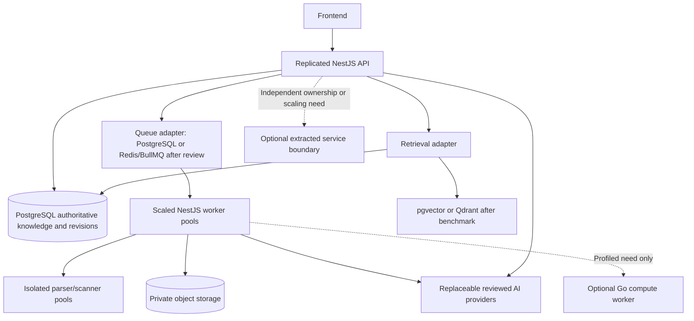

# ADR-010 — Lean MVP deployment with preserved domain boundaries

Version: 1.0.0. Recorded: 2026-10-16. Owner: Architecture / Engineering. Status: recommended deployment baseline — pending architecture/security/operational review (D-ARCH-01). Delivery: specified, not migrated or benchmarked. Preserves NestJS/Prisma decisions in [ADR-009](08_BACKEND_AUTH_AND_CONSTRAINTS_ADR.md). Supersedes the Engineering Bible’s default Go, Qdrant and Redis/BullMQ deployment proposal for MVP planning; historical decisions remain history. No scope or Founder approval is inferred.

## Context and decision

The [seven-feature MVP](../MVP_SCOPE.md) needs approved, versioned business facts, asynchronous source processing, persistent conversations and provider calls. It does not need media rendering, crawling, independently deployed domain services or a second implementation language. The existing schema has no vector column or general-purpose queue model; its KnowledgeIndex is a relational approved-entity projection, not an embedding store. Service names define ownership and contracts, not network boundaries.

Recommend Next.js, one NestJS TypeScript backend codebase/release, PostgreSQL/Prisma, private object storage and one explicitly configured reviewed MVP AI provider (not selected here). Run that backend as an HTTP/SSE API role and a durable background worker role using the same release artifact and module contracts. Workers use a PostgreSQL-backed queue adapter, with pg-boss the recommended library pending version, transaction and operational review. Do not build a custom queue engine. Keep isolated parser/scanner execution outside the API process with restricted filesystem/network/credentials. A worker role/process is not a separately owned microservice or second domain database.

Start context retrieval with tenant/Brand/current-revision scoped structured approved facts, bounded field selection and keyword/metadata ranking. For the small structured Brand Brain, explicitly selecting mandatory/relevant facts can satisfy contextual generation without embeddings. Validate answer quality/token budgets before release. If vector search is necessary to meet that evaluation, add pgvector in the same PostgreSQL deployment first; it is not assumed installed. Qdrant is a future option requiring measured justification. Raw imported documents and candidates never become generation-retrievable simply because they are stored or embedded.

## Alternatives evaluated

| Component | Earlier proposed stack | Lean MVP recommendation and tradeoff |
| --- | --- | --- |
| Next.js frontend | Next.js + TypeScript UI tools | Retain. No second public business/auth implementation in Next route handlers; NestJS owns authorization/mutations. UI host may be separate from backend host; streaming/session/CORS settings must be tested. |
| Backend | NestJS modular backend | Retain modules and thin application orchestration in one codebase/release. Calling an internal contract does not require HTTP. Independent deployment adds versioning, network failures and distributed transactions without evidenced need. |
| Database / ORM | PostgreSQL + Prisma 7 | Retain canonical snapshots, revisions, relational projections, schema constraints and transactional publication. Backups, connection budgets and migration discipline remain required. |
| PostgreSQL vector search vs Qdrant | Qdrant listed as default | Baseline needs neither vector engine until quality requires it. pgvector first if needed: one database/backup/access system, but extension/schema/index/query and resource-isolation work remains. Qdrant can independently scale vector workloads but adds replication, tenant-filter, deletion and recovery consistency obligations. |
| Original documents | Cloudflare R2 | Retain private S3-compatible object storage behind an adapter; R2 remains proposed vendor, not deployed infrastructure. Persist object key/hash/media metadata in source artifacts, not raw bytes in every JSON snapshot. Preserve evidence references when bytes expire under policy. |
| Background work | Redis/BullMQ | Keep durable asynchronous import/retry/cleanup using a PostgreSQL-backed queue (pg-boss recommendation), avoiding another stateful system. Redis/BullMQ remains a valid later adapter if benchmarks or required queue features justify it; queue libraries do not make business effects exactly-once. |
| Workers | Go workers for AI/media/heavy work | TypeScript/NestJS worker bootstrap reuses modules/adapters. Most import/provider waits are I/O; native parser subprocesses must be isolated. Go only after profiling shows a CPU/runtime requirement and ownership for a second toolchain. Video/image work is outside this MVP. |
| Deployment | Broad stack with multiple infrastructure services | One backend release, two role configurations, no per-domain microservices. Separate parser security sandbox is mandatory even at low traffic; operational simplicity cannot remove it. |

## MVP component diagram — recommended, not deployed

API/worker share domain code, not broad credentials. Restrict parser credentials/network, worker operations, object keys and fetch egress per the [security threat model](../SECURITY_THREAT_MODEL.md). Deployment may use a worker container from the same image and a constrained parser process/container profile; process separation alone is insufficient proof of sandboxing. Scanner implementation/runtime is D-SEC-01, not a second business language decision. No Kubernetes, service mesh or event broker is required by this recommendation.

## Future architecture diagram — conditional options, not a roadmap commitment

Scale role replicas before extracting domains. Future vector/queue/compute options are alternatives, not a requirement to deploy every box. Agency/multi-brand features require separate product approval and tenant/RBAC/billing design regardless of infrastructure capacity.

## Infrastructure dependencies and estimated operational complexity

Estimates are comparative engineering judgment, not measured staffing, cost, throughput or availability promises. Count long-running application roles separately from stateful systems and optional services; external providers, observability and parser/scanner supervision still create work.

| Dependency | MVP need / ownership | Operational work and failure behavior |
| --- | --- | --- |
| Next.js host | Required UI role / Frontend | Build/release, TLS, API connectivity and session integration; no long-running imports in UI requests. |
| NestJS API runtime | Required role / Engineering | Guards, validation, SSE disconnect/recovery, readiness and graceful shutdown; no parser CPU on HTTP event loop. |
| NestJS worker runtime | Required role, same release / Engineering + Operations | Durable claims, leases, bounded concurrency, retries/dead-letter handling and scheduler/reconciler health; API remains responsive during import. |
| PostgreSQL | One stateful database system / Operations | Backups/PITR where approved, restore rehearsal, pool sizing, queue maintenance/vacuum, migrations and tenant-query review. API and workers compete for resources; budget connections separately. |
| Private object storage | One stateful storage system / Operations | Encryption, private access, scan quarantine, lifecycle/reference retention, signed-write restrictions and authorization-gated reads. Not an optional local-disk substitute. |
| Parser/scanner sandbox | Required execution profile / Security + Operations | Dependency patching, malware engine updates, process limits, no network/secrets, kill/cleanup and capacity alerts; file intake remains gated on readiness. |
| pg-boss / PostgreSQL queue adapter | Recommended library, not another database / Engineering | Pin supported Node/PostgreSQL/library versions; approve library schema installation/migrations and Prisma integration. No runtime migration owner privileges. |
| AI provider adapters | Required external dependency / Engineering + Security/privacy | Explicit allowlist, minimized data, credentials, bounded retries/timeouts, cost quotas and no unreviewed fallback. |
| Logs, metrics, alerts, secrets | Required platform facilities / Operations | Content-minimized audit/telemetry, key rotation, backlog/purge/failure alerts, incident ownership and tested disable controls. A chosen platform may supply these without new standalone stores. |
| pgvector | Conditional first vector option / Engineering | Extension support, versioned embedding projection, query plans, quality/recall and load tests; no mandatory MVP migration until needed. |
| Redis/BullMQ, Qdrant, Go, separate domain services | Deferred / future decision owners | No launch dependency by default; each adds credentials, upgrades, monitoring and failure/recovery contracts. |

Earlier proposal: frontend + backend + Go worker runtime (three application roles/two languages), PostgreSQL + Redis + Qdrant (three database/queue systems), object storage, parser isolation and providers. Recommended: frontend + two roles of one TypeScript backend release (three application roles/one application language), PostgreSQL (one database/queue system), object storage, parser isolation and providers. Stateful systems including object storage drop from four to two. Both require security, monitoring and backup operations. Relative complexity: recommended **moderate**, earlier **high** for a small team; no fabricated dollar or person-day estimate. pgvector adds extension/index operations but no new database service. Parser/scanner execution is additional supervised capacity in both counts, not hidden inside a “single process” claim.

## Durable work and consistency contract

Imports must survive HTTP disconnects/restarts. Acquire a validated source, persist accepted work durably and return the existing operation/correlation reference; polling remains the specified UI path. Parsing/extraction and delayed retries run asynchronously. Normal Workspace generation may stream from API with persisted Message attempt state; queue it only when concurrency/backpressure warrants, preserving the PRD’s direct dispatch path. Purge receipt state remains ConversationPurge; queue scheduling never replaces that durable deletion ledger.

Queue jobs contain tenant/Brand/operation IDs and minimal references, not raw prompts/files/tokens. Transport status/attempts are not a second import-domain status store. Existing artifact/decision-derived UI status and unresolved R23 remain intact. Make accepted import state and enqueue atomic using a reviewed same-transaction library adapter; if incompatible, require a durable outbox and reconciler before release. An enqueue-after-commit call with no recovery is unacceptable. The concrete library version/transaction adapter is D-ARCH-01; this ADR does not claim it exists in the repository.

Assume redelivery and crash after external side effects. Revalidate tenant/tombstone/head before work and publication; use scoped idempotency/operation keys, bounded retry/backoff, lease heartbeat/fencing, dead-letter alerts and manual retry rules. Provider timeouts may incur duplicate charges even when database effects are idempotent; record attempts and bound spend. Do not hold a database transaction/row lock open across a provider or parser call. Publication is a short transaction; lease claims use separate bounded transactions. Reconcile lost/stalled work, schedule purge retries/holds from their ledger and disable queue claims during orderly shutdown. Library claims of exactly-once delivery never remove application idempotency requirements.

Queue schema is library-owned infrastructure state separate from Prisma business models, managed by reviewed versioned deployment migrations. Do not fabricate a new ImportJob domain model, reuse Artifact.status as queue execution state or reinterpret ConversationPurge as a general queue. Queue backup/retention/restore replay must be covered by the same operational data inventory; restoring old jobs cannot republish deleted or superseded data. No queue table/extension is declared installed by schema.prisma.

## Migration plan and rollback

1. Inventory actual application code/config/infrastructure first. This repository records earlier proposals, not evidence that Go, Redis or Qdrant are running. If none exist, implement the recommendation directly; do not perform a fictitious migration.
2. Review D-ARCH-01 and security/policy gates. Pin runtime/library versions, test same-transaction enqueue, establish object/fetch/parser isolation, load budget and recovery runbooks. Keep Prisma/SQL constraints and immutable revision evidence intact.
3. Build adapters for queue, object storage, retrieval and AI providers behind current service contracts. Add reviewed library schema migrations separately from business Prisma migrations. Rehearse on disposable data, backup/restore and crash/retry tests; deploy readers before incompatible payload writers.
4. If replacing a real queue, stop intake/claims at a controlled boundary, inventory in-flight operations, drain or migrate using stable tenant/operation identity, then enable one consumer authority. Never process the same operation under two unfenced backends. Preserve failed/purge receipts. Rollback pauses new dispatch and resumes the old adapter only after operation reconciliation.
5. If replacing a real vector store, build a derived approved-revision projection in the new backend, compare tenant-filtered quality/latency and source references, shadow-read without user disclosure, then switch the retrieval adapter. Dual-write via durable replay/outbox if required; stale projection fails closed or uses bounded canonical retrieval. Delete old copies under approved retention after verification. Rollback returns to a verified matching projection, never to erased tenant data.

No infrastructure, dependencies, queue migrations, extensions or application schema changes are performed by this documentation task. Existing Prisma and SQL contracts remain unchanged. A future pgvector projection needs a separate schema/migration ADR: tenant, Brand, revision/fact identity, embedding model/version/dimension and content digest, uniqueness, delete/rebuild rules and parameterized tenant-filtered queries. Embeddings are derived, never new knowledge authority. ANN index/filter tradeoffs require recall tests; exact scoped search is the first comparison baseline.

## Proposed scaling triggers and technical risks

Thresholds below are investigation gates to approve in D-ARCH-02, not observed performance or promises. Establish baseline on representative sanitized single-source workloads and expected concurrent tenants first. Measure p95/p99 API/context latency, oldest queued age, completion rate, lease redelivery, database CPU/I/O/lock time/connections, parser peak memory and cost. Existing <30s import goals and TTFV goals remain proposed and do not justify bypassing controls.

| Trigger / evidence | First action | Escalation only if still needed |
| --- | --- | --- |
| Import backlog age repeatedly exceeds approved service budget in three representative peak windows despite bounded concurrency | Tune worker replicas, provider quotas and per-tenant fairness; check DB/provider bottleneck | Redis/BullMQ if measured queue load/features cannot meet budget without harming PostgreSQL; rehearse loss/replay first |
| Context p95 or factual quality fails agreed evaluation on representative largest Brand Brains | Tune bounded structured/keyword selection and indexes; introduce pgvector if semantic retrieval improves evaluated results | Qdrant only after pgvector benchmark cannot meet quality/latency/resource budgets at expected scale |
| Queue/vector work consumes approved PostgreSQL API resource budget under repeatable load | Pool/concurrency limits, indexes and scheduling; scale database or isolate role workload | Separate queue/vector infrastructure with durable projection/outbox and deletion replay |
| Worker CPU dominates provider/I/O wait and measured TS implementation cannot meet approved cost/latency budget | Profile algorithm/native parser/runtime and scale worker pool | Go worker only with demonstrated improvement, contract/observability parity and maintenance owner |
| Independently scaling/team-owned module cannot release safely within one backend despite modular contracts | Independent role configuration and clearer module APIs | Extract microservice with versioned contracts, idempotency, tenant identity propagation and recovery ownership |

Key risks: shared PostgreSQL failure/queue contention; library/runtime version compatibility and hidden queue migration privileges; unbounded parsers/SSRF; stale retrieval projections; publication/enqueue race; provider costs/timeout duplication; SSE hosting limits; object/reference retention drift; complexity moved into homegrown adapters. Mitigate through managed storage, connection budgets, maintained queue library, sandboxing, fail-closed revision checks, short transactions, evidence-based testing and explicit ownership. Do not counter simplicity by writing a custom distributed scheduler or skipping backups/security.

## Required validation and reference basis

Before enabling recommended infrastructure: restart during accepted import; kill worker after provider result/before commit; replay duplicate/out-of-order job; deny forged tenant; restore database/queue with deletion tombstones; verify queue outage does not lose accepted work; exercise parser limit/SSRF corpus; confirm new approved revision/context pinning; verify object access/cleanup; load-test pool isolation and queue backlog. Link runtime results to exact revision/environment. This document supplies no passing runtime result.

The [pg-boss project](https://github.com/timgit/pg-boss) documents PostgreSQL-backed Node job processing, transactional integration and retries; compatibility with the selected Prisma/runtime still requires testing. [pgvector](https://github.com/pgvector/pgvector) documents exact and approximate PostgreSQL vector retrieval. [BullMQ idempotency guidance](https://docs.bullmq.io/patterns/idempotent-jobs) supports retry-safe application effects, and [Qdrant multitenancy](https://qdrant.tech/documentation/manage-data/multitenancy/) illustrates additional tenant-filter/index design if that option is adopted. The recommendation and complexity estimates here are project-specific engineering judgments, not vendor guarantees.

## Task17 — Shared provider module within ADR-010

[ADR-011](10_AI_PROVIDER_GATEWAY_ADR.md) and [Gateway contracts](../contracts/ai-provider/README.md) specify one DI-only platform module reused by Extraction in the worker role and Orchestrator in the API/worker role. No extra microservice, language, database or provider ledger is introduced. Only Gateway adapters contact the external provider; caller-owned immutable artifacts remain durable receipts. Queue claims, fencing and shared quota reservations must span replicas, not rely on process-local maps. Transport retries and caller regeneration consume one operation budget/deadline; no transaction stays open during external I/O. Ambiguous vendor charges remain possible after crashes/timeouts. Provider, numeric-policy and runtime security/lease/atomic-integration approvals stay D-SEC-02/D-GW-01/D-ARCH-01/02. No infrastructure migration is claimed.

## Task18 — Import claims are not business status

[ADR-012](11_IMPORT_LIFECYCLE_ADR.md) defines Brand-locked Artifact admission/attempt/review/closure authority. Queue job identity/visibility/heartbeat/fence and retry scheduling are infrastructure, never import completion. Durable closure releases the proposed D-IMP-02 slot, including review; queue success/lease expiry/client exit cannot release it. Verify closure/receipts on redelivery, recheck grants/deletion/fence before writes and hold no transaction across provider/parser I/O. Atomic enqueue/outbox and distributed claim behavior still require D-ARCH-01 review/integration tests; no infrastructure migration or new microservice.
