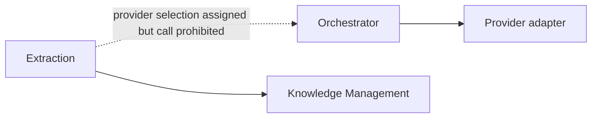
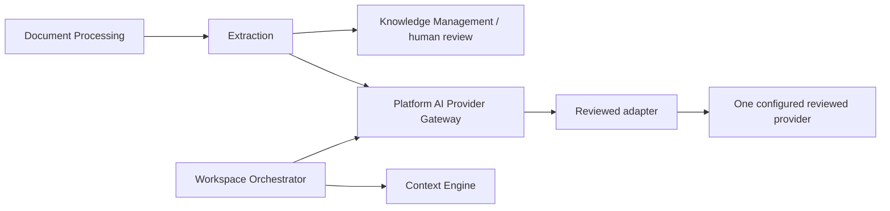

# ADR-011 — Shared internal AI Provider Gateway

Date: 2026-10-18. Owner: Architecture + Security; Engineering owns implementation. Status: **Specified — Pending Architecture/Security Review (D-AUD-02)**. No reviewer approval, deployed module, provider selection or production integration test is recorded. This recommendation preserves the seven-feature MVP and ADR-010 modular monolith.

## Audit and contradiction matrix before changes

The following is the inspected pre-change baseline, recorded before reconciliation. Paths use actual repository names: backend/auth ADR is `08_BACKEND_AUTH_AND_CONSTRAINTS_ADR.md`, lean deployment is `09_LEAN_MVP_ARCHITECTURE_ADR.md`; the proposed 07/08 architecture paths in the task do not exist. Read the decision register, final audit, scope, security, provenance, Engineering Bible, Extraction/KM/Orchestrator specs, Artifact/API models, lean ADR, Prisma and relevant v2 schemas/registry. Also checked all six service specifications for provider dependencies.

| Topic / baseline sources | Contradiction or gap | Specified disposition |
| --- | --- | --- |
| Extraction Model Independence / Downstream Integrations | Provider selection exclusively belongs to Orchestrator, but calling it is prohibited | Extraction calls Gateway through DI, never Orchestrator or a vendor SDK |
| Orchestrator Upstream Dependencies / LLM Provider Adapter | Other services cannot use LLMs; common adapter ownership omits extraction | Only Gateway adapters contact providers; authorized Extraction and Orchestrator are its two callers |
| Extraction Prompt Management / Orchestrator Prompt Builder | Both own prompts; no shared invocation boundary distinguishes purposes | Keep separate template registries/ownership, shared policy enforcement; no Workspace capability for extraction |
| Orchestrator Stage 8/9 / adapter retries / ADR-010 recovery | Retry and regeneration ownership can multiply attempts and spend | Gateway transport attempts and caller logical retries consume one operation-wide reservation/deadline |
| Engineering Bible provider list / both Model Independence sections | Named vendors can imply configured/approved support | One configured reviewed MVP provider; none selected here; no fallback |
| Artifact v2 PROMPT/RESPONSE vs KNOWLEDGE_CANDIDATE | Extraction provider details do not fit Workspace artifacts; no extraction-specific provider ledger exists | Keep all v2 files unchanged; use existing provenance plus bounded content-free operational telemetry |
| Security SEC-T01/04/06 / D-SEC-02 | Disclosure, tenant checks and budgets exist without one enforcement interface | Gateway enforces reviewed purpose/tenant policy; provider/privacy and numeric operational approvals remain open |

## Decision and boundaries

Use one **AI Provider Gateway** platform/infrastructure NestJS module in the same backend codebase, bootstrapped in API and worker roles. It is DI-only: no public/internal HTTP endpoint, new deployment, autonomous agent, knowledge authority or replacement Orchestrator. Vendor SDK imports and credentials are restricted to Gateway-owned adapters. Gateway has no approved-knowledge repository, retrieval, mutation or publication permission. Callers supply already-authorized minimal task data. Data supplied to a model is never authority.

| Component | Owns | Must not own |
| --- | --- | --- |
| Knowledge Extraction | Deterministic-first rules; versioned extraction templates; typed task requests; ontology/field/evidence validation; KNOWLEDGE_CANDIDATE checkpoints | Workspace planning/Message/Conversation/PROMPT_CONTEXT/RESPONSE; direct SDK; approval/publication |
| AI Orchestrator | Workspace capability planning; generation templates; model request subject to policy; logical generation retries; final response validation; existing PROMPT/RESPONSE and Message completion | Extraction entry point; context retrieval; knowledge mutation; vendor SDK |
| Context Engine | Approved, pinned, tenant-scoped context assembly and PROMPT_CONTEXT | Provider calls or approval |
| Gateway | Caller/purpose/tenant enforcement; extraction model selection; generation selection validation; budgets, concurrency/rates; adapter invocation, structural validation, error/usage normalization, transport retries and safe telemetry | Business fact interpretation/approval; raw source fetching; model-directed tools; artifacts or business execution ledger |
| Adapter | Vendor formatting, server credential authentication, bounded transport, normalized vendor output/usage | Independent retry/fallback/model selection, template/business policy, durable publication |
| Knowledge Management | Independent governance, authorized human decisions, atomic approved snapshot/revision/head/projections | Provider execution or treating model confidence/success as approval |

## Before and after dependencies

Before (conflicting specification, not runtime evidence):



After (specified, review pending):



There is no E→O, G→K, G→C or G→approved database edge. HTTP/SSE ownership stays in Workspace. [ADR-010](09_LEAN_MVP_ARCHITECTURE_ADR.md) retains one release, API/worker roles, PostgreSQL queue integration and parser isolation.

## Canonical invocation contract

[Internal DTO contracts 1.0.0](../contracts/ai-provider/README.md) and their local registry are the single machine-readable request/terminal-response/output definitions. `invoke(request, trustedExecutionContext, abortSignal): Promise<Response>` is a NestJS interface, not REST. The trusted context is an opaque in-process capability issued by the authenticated application/worker boundary, not deserialized from the request or source. It binds caller identity, initiating Owner/session authorization grant, organization, Brand, job/Message ownership and current lease. DTO `caller` is only an asserted identity checked against that capability. JSON Schema validates shape, never authentication or reference ownership.

Callers own templates and task semantics. Gateway loads the exact reviewed instruction template by ID/version/digest and policy registration; it never treats a caller-supplied URL or text as a trusted template. Caller constructs untrusted task data separately; adapter formats roles/delimiters without upgrading source instructions to policy. All output schema references are local registry IDs, not remote URLs or caller-provided schemas. Output size limits apply before parsing; no coercion, defaults, property stripping or network schema resolution. Schema-valid output still requires caller semantic validation.

## Provider policy and precedence

Fail closed until D-SEC-02 and D-GW-01 approvals exist for each enabled purpose. There is no selected vendor, commercial contract, residency guarantee or approved numerical budget in this ADR. Synthetic fixture policies are not deployment defaults.

1. Deployment review registers exactly one active provider, explicit model keys/actual model versions, adapter, permitted region, purpose/capability support (structured JSON, bounded text/streaming), price version and data-handling disclosure. Policy snapshots are immutable ID/version registrations.
2. Intersect deployment allowlist and purpose policy with organization restrictions/consent and current actor grant. Organization configuration may narrow, never widen; missing region/data-category/price evidence or no intersection denies. A caller cannot replace policy by version, environment variable, source instruction or model output.
3. Extraction requests no model (`requestedModelKey: null`); Gateway selects that purpose's one reviewed default. Orchestrator requests its selected model explicitly; Gateway accepts exactly that allowed key or denies, with no silent substitution. Registry keys are not vendor display names. Check required capabilities, approved data classification and actual adapter destination/region before disclosure.
4. Effective limits are the minimum of caller, purpose, organization and deployment caps. Enforce finite input/output tokens, total wall time/deadline, output bytes, per-operation cost, total physical attempts, backoff, concurrent calls and request/token rates. Larger requests are denied, not silently truncated into a different task. Budget/rate denials use RESOURCE_LIMIT with a safe retry hint only when policy permits.
5. Before each call reserve conservative worst-case input/output cost at a reviewed price/currency plus uncertainty margin, atomically against shared operation and tenant quotas. No safe upper bound means no call. Reconcile measured usage; unknown token/cost values remain null/UNKNOWN, reserve the worst case until reconciliation, alert, and do not treat them as zero. A hard application reservation is not a provider invoice guarantee. Unknown or incompatible currencies/price versions deny. Physical retries also consume reservations.
6. No alternate provider, region, tenant credential or model fallback in MVP, including outages/429. Provider disabled/unreviewed means no disclosure. Queued attempts wait only within the original deadline and admission policy; unavailable capacity returns a bounded normalized failure.

D-GW-01 requires Architecture, Engineering, Security and Operations review of exact caps, price uncertainty, concurrency/rate fairness, deduplication window and telemetry retention (with Legal/privacy for retention and Product for budget/UX impact). D-ARCH-01 covers queue/atomic integration; D-ARCH-02 covers measured capacity budgets. Disabling a canonical capability indefinitely is a Product/Founder scope decision, not a hidden fallback.

## Extraction flow and partial outcomes

```mermaid
sequenceDiagram
  participant D as Document Processing
  participant E as Extraction
  participant G as Gateway
  participant A as Reviewed adapter/provider
  participant K as Knowledge Management
  participant H as Authorized Owner
  D->>E: VALID + SUCCEEDED STRUCTURED_DOCUMENT reference
  E->>E: Authorize source and tenant; deterministic extraction
  alt Model assistance needed and permitted
    E->>G: Typed KNOWLEDGE_EXTRACTION + trusted execution context
    G->>G: Caller, tenant, purpose, template, policy, budget/lease checks
    G->>A: Minimal untrusted excerpts; trusted template; no tools
    A-->>G: Structured result / normalized transport failure
    G->>G: Byte/schema checks and normalized usage/error
    G-->>E: Typed terminal DTO
    E->>E: Ontology, requested field and genuine source-evidence validation
  end
  E->>E: Recheck authorization, cancellation, lease and source deletion
  E->>K: Existing VALID + SUCCEEDED extraction candidate only
  K->>K: Independent governance; pending review, never auto-approved
  H->>K: Approve/edit/reject with current authorization and expected head
  K->>K: Atomic versioned publication only after human approval
```

Deterministic extraction that satisfies the requested extraction scope emits existing extraction SUCCEEDED with actual RULE/PATTERN/ONTOLOGY provenance; it performs no Gateway call and records no fictional model/template usage or zero-cost provider execution. Empty facts can be a valid result when nothing supported is found. Confidence remains an indicator, never truth or approval.

If model assistance was required for the selected scope and fails while deterministic candidates exist, append an existing extraction PARTIAL checkpoint with the valid deterministic fragment and error null, plus a separate FAILED/CANCELLED/TIMEOUT extraction_stage checkpoint with the existing safe error. Do not label PARTIAL VALID+SUCCEEDED, forward it as a complete import or auto-publish it. Keep the approved head unchanged. Retry within the operation budget or report the limitation; no automatic switch to a smaller successful task. Exact aggregate import UX/closure/admission behavior remains D-AUD-07/D-IMP-02 (Product/Architecture/Founder as registered). Enabling user acceptance of partial imports requires that review; this ADR adds no screen or new partial-approval product capability. If no usable fragment exists, emit the failed operation variant with null or schema-valid diagnostic fragment. Existing contract rules determine ArtifactStatus, independently of operationStatus.

## Workspace generation flow

```mermaid
sequenceDiagram
  participant W as Workspace / Message
  participant O as Orchestrator
  participant C as Context Engine
  participant G as Gateway / adapter
  W->>O: Authorized generation attempt
  O->>C: Approved-context request
  C-->>O: Existing PROMPT_CONTEXT pinned to approved revision
  O->>O: Plan model under policy; build existing PROMPT
  O->>G: WORKSPACE_GENERATION typed request + trusted execution context
  G-->>O: Structurally validated text / safe terminal failure
  O->>O: Business, grounding, safety and final response validation
  O->>W: Recheck grant/lease/deletion; atomic RESPONSE linkage + Message COMPLETED
  W-->>W: Existing single-response SSE final outcome
```

Gateway success only means bounded transport/output schema success, not factual correctness or Message completion. PREPARING_CONTEXT and GENERATING remain per-assistant Message states; final validation and durable linkage precede COMPLETED. FAILED/CANCELLED/TIMEOUT end only that attempt, never its Conversation. Explicit user retry creates the existing new Message/correlation. Generation never mutates knowledge.

MVP Gateway interface returns a bounded terminal response; it may buffer provider output and Workspace may stream checked text through its existing SSE transport. This does not require provider-token pass-through or a new SSE protocol. If runtime later implements direct provider chunks, it must first specify/review an internal event extension with monotonic sequence, limits, cancellation and pre-release checks; no arbitrary vendor chunks may bypass final validation. Existing SSE recovery/DTO gaps stay D-AUD-08. No new public cancellation route is defined.

## Reliability, cancellation and accounting

Gateway owns physical transport retry/backoff; adapter performs no hidden retries. Retry transient network failures, 429 and 5xx only when the remaining attempt, cost and deadline budgets allow it. Authentication/authorization/policy, invalid input/schema, unsafe content and non-transient vendor 4xx are permanent. Exhausted transient errors remain retryable indicators for a caller only if a new attempt is admitted under the original operation budget; they do not grant permission to retry indefinitely. Normalize timeout/cancel to TIMEOUT/CANCELLED. Retry-After is capped by policy and remaining deadline; otherwise stop. Use exponential backoff with bounded jitter and policy max. Recheck authorization, lease, cancel and budget before every physical attempt.

Orchestrator owns logical regeneration after its semantic/final validation, with the next unused attemptNumber and new attempt receipt under the same stage invocationId and remaining shared operation budget, never an independent multiplier of Gateway retries. Extraction does not ask Gateway to repair semantic errors automatically. Each stage keeps its stable invocationId across retries. Request attemptNumber is the first reserved 1-based stage attempt; physical dispatch k consumes attemptNumber+k−1, matching Artifact v2 retry numbering. A terminal caller checkpoint records the last dispatched attempt (or the request number for preflight denial); the next logical request starts after all consumed numbers. physicalAttempts reports the count, not an alternate Artifact attempt counter. Each admitted logical request batch uses its own stable idempotency key under tenant+caller+purpose+correlation+attempt. Same key/body replays the caller's existing artifact receipt; changed body returns CONFLICT. Request fingerprint uses the existing stable-json-v1/SHA256 convention, excluding the fingerprint field itself and opaque trusted context. Deadline and immutable template/policy references are included. No cross-tenant/provider response cache.

Durable import identity and lease/fencing come from existing queue/application infrastructure, not a new Prisma job/provider ledger. `workRef` binds the existing import correlation/job identity or assistant Message; live generation may use a null job/lease only under the application Message execution claim. Worker calls require a current lease and fencing token. Gateway deduplication in memory alone is insufficient across replicas/restarts: caller checks existing immutable stage/final artifact receipts and short transactional claims before dispatch and publication, integrated with the reviewed queue library/outbox. New physical retries are charged against shared reservations in approved infrastructure. No database transaction/row lock stays open during provider I/O. A lost reply can cause duplicate vendor charges unless vendor idempotency is supported and verified; do not claim exactly-once external execution. Record safe attempt metadata and reconcile ambiguity, never duplicate final publication.

Propagate AbortSignal and absolute deadline to the adapter; abort locally on timeout/revocation, discard late output, and account possible external charges. Provider cancellation is best effort and not erasure. Recheck current tenant/Owner grant, Brand/source/Conversation tombstones, pinned references, lease fence and operation claim after awaiting and immediately before any durable downstream emission; KM rechecks again on human publication. Commit final Message with conditional expected state and unique response linkage; KM uses existing operation idempotency/expected-head transaction. Stale workers cannot win publication. Apply per-tenant/purpose rate buckets and concurrency partitions with global caps so an import cannot starve Workspace. Admission, reservation and claim persistence are ADR-010 implementation dependencies, not implemented claims.

## Security and privacy launch controls

Authenticate module caller using trusted DI capability plus current user/job grant, not a `caller` JSON string. Credentials are server-only adapter secrets with least privilege/rotation; never request/prompt/artifact/log fields. Fetching stays in Ingestion's SSRF-controlled boundary; Gateway/provider cannot browse, fetch URLs or execute tools. Imported source and user/history text stay untrusted, even when retrieved from approved records; models cannot set policy, tenant, templates, providers, approvals or network destinations. Injection resistance is imperfect: strict role separation, minimized bounded input, no tools, schema validation and independent source/business checks reduce consequences without guaranteeing model obedience.

Before egress check allowed data categories, redact seeded secrets/unnecessary sensitive data, purpose-specific disclosure and approved provider terms/retention/training/region (D-SEC-02). Unknown handling blocks the path. Enforce bounded text/arrays/output bytes, Unicode-safe parsing, safe normalized errors and safe renderer checks before SSE. Raw provider exceptions/bodies, prompts, source text, full URLs, credentials and sensitive vendor request IDs never enter logs. Telemetry allowlist: invocation/correlation, tenant/Brand IDs under restricted access, caller/purpose, template/policy/schema/model registry versions, attempt counts, state/error/diagnostic ID, latency, token counts, cost/currency/knownness; a vendor request ID may be represented only as an approved non-reversible operational digest. No content hashes enabling cross-tenant inference in general telemetry. TTL, access controls and purge ownership require D-POL-01/D-SEC-03/D-GW-01 review. This is minimized operational telemetry, not an additional business execution ledger or approval store.

Required before either enabled provider path: D-AUD-02 review, D-SEC-02 provider/privacy evidence, D-GW-01 concrete policies, actual auth/tenant/budget/lease/adversarial/recovery tests and SEC release gates. Later options include additional provider adapters, circuit-breaker tuning and a reviewed stream extension; none authorizes fallback or replaces required bounds. No regulatory certification or runtime implementation is claimed.

## Artifact compatibility and migration

| Internal information | Existing destination / meaning |
| --- | --- |
| invocationId/correlationId, attemptNumber | Existing stage invocationId and envelope correlationId; terminal checkpoint attemptNumber is request attemptNumber + max(physicalAttempts,1) − 1. Each actual retry consumes the next stage attempt; checkpoints get new artifact IDs/checkpointNumber |
| organizationId/brandId | Existing envelope organizationId/payload brandId; validate equality against authenticated context, never copy model IDs |
| Extraction output | Extractor validates and converts proposals into existing extraction_stage/extraction data; provenance.extractionMethod LLM only if actually used, actual pipelineVersion and genuine evidence |
| Extraction template, provider/model/price/physical-attempt details | No such extraction payload fields in v2; content-free reviewed telemetry keyed by invocation/correlation. Do not overload pipelineVersion or create PROMPT/RESPONSE for extraction |
| Generation template/model | Existing PROMPT data.templateVersion/promptVersion/modelConfiguration; policy-preselected model must equal Gateway's actual execution |
| Generation output/usage/cost | Existing RESPONSE generatedResponse/modelProvider/modelName/tokenUsage/latency/estimatedCost after Orchestrator final validation; unknown counts/cost null |
| Gateway output validation vs final validation | Structural Gateway success is not RESPONSE validationResult.passed; that result belongs to Orchestrator's final validator |
| Failure | Existing closed Artifact v2 error codes/object; POLICY_DENIED, RESOURCE_LIMIT, PROVIDER_FAILED, OUTPUT_INVALID, TIMEOUT, CANCELLED etc. No vendor enum leaks |

All `contracts/artifacts/2.0.0` files and Prisma models/enums are unchanged. Gateway DTO version is independent and ephemeral; never store it wholesale as an Artifact payload or add a Gateway ProducingService/ArtifactType. No business data migration is required. Deploy local DTO readers/validators before callers/adapters, pin versions/digests, fail closed on unknown versions and retain historical artifacts with existing version readers. No older artifact is relabeled or rewritten. Extraction execution detail is intentionally operational, not an independent durable business ledger; if future requirements demand durable provider attestations inside extraction history, propose a separate minor Artifact bundle with optional execution reference, reviewed retention/reference rules, dual readers and staged writers. That is not required/authorized by this task and no v2 amendment is made.

## Acceptance, open decisions and runtime work

AT-17-01–17, valid/invalid examples and actual offline results are indexed in [Gateway contracts](../contracts/ai-provider/README.md) and [Task17 results](../validation/TASK17_RESULTS.md). Tests are a standalone executable specification with fake adapters, authorization state and receipts. They do not demonstrate real NestJS guards, provider privacy, database races, network cancellation, distributed quotas or billing correctness.

Review roles: D-AUD-02 Architecture/Security; D-SEC-02 Security + Legal/privacy + Product; D-GW-01 Architecture/Engineering/Security/Operations plus relevant budget/privacy owners; D-ARCH-01 queue integration; D-ARCH-02 capacity; D-AUD-04 Artifact review; D-AUD-07/D-IMP-02 partial/closure UX; D-AUD-01 history; D-AUD-08 SSE/API integration; D-POL-01/D-SEC-03 retention. Existing Founder product decisions are unchanged.

Implement next: reviewed template/model/policy registries and opaque execution grants; NestJS Gateway/adapter; atomic quota reservations and queue/lease integration; caller artifact mapping and idempotent commits; actual provider/privacy configuration and disclosure; fault/adversarial/tenant/concurrency tests and monitored disable switches. Record exact runtime revision/environment and reviewer evidence before sign-off.


## Task18 — Import aggregate lifecycle reference

[ADR-012](11_IMPORT_LIFECYCLE_ADR.md) now specifies D-AUD-07 at review-pending level, preserving this ADR and Gateway1.0.0 unchanged. Provider TIMEOUT/FAILED does not imply terminal import until retry exhaustion/permanent closure; partial deterministic extraction remains unreviewable. Selected stage invocation/attempt ranges and current lease fence bind Gateway results; recheck current grant/source/deletion before Artifact writes. No Gateway success approves facts or closes review. Exact admission interval, partial acceptance/expiry/force-close policy and numeric budgets remain their registered pending decisions.


## Task22 — Bounded conversation history

**Specified — Pending Product/Architecture/Security Review (D-AUD-01), 2026-10-21.** [ADR-016](../domain/15_CONVERSATION_CONTEXT_AND_HISTORY_ADR.md) and [history1.0 contracts](../contracts/conversation-context/README.md) define canonical rules and pending gates.

ADR-016 proposes history1.0/Artifact2.5 without changing Gateway1.0. Orchestrator supplies reviewed generation template's data-only task.content and existing trustedInstructionRef; Gateway never queries Message history, selects approved business facts or appends another current user message. Actual provider wire uses existing SYSTEM/USER roles, historical role labels are untrusted data. Exact model/tokenizer/template/serialization partition checks and final whole-wire counts require D-GW-01 review; fixture byte counts are not production estimates. Authorization/deletion/privacy checks remain before invocation/publication, and no alternate provider/tool/memory capability is authorized.
