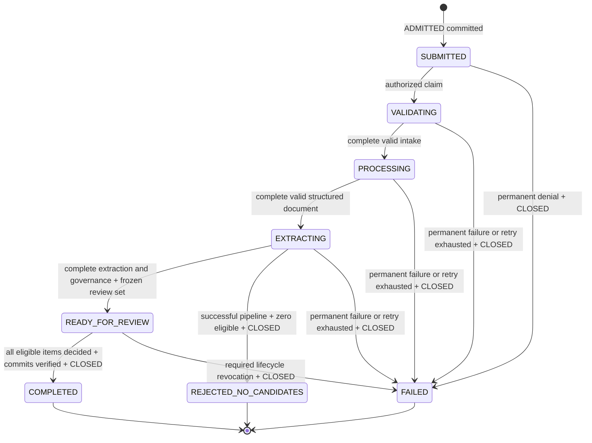
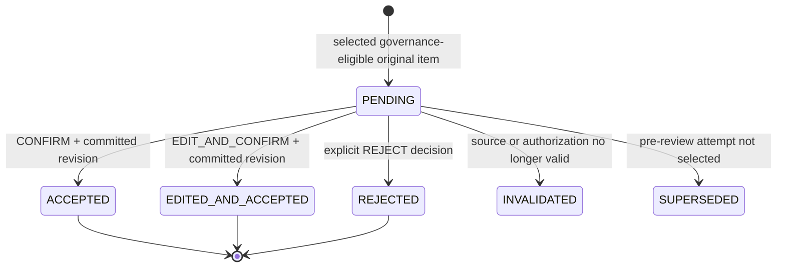

# ADR-012 — Deterministic import lifecycle and review closure

Date: 2026-10-18. Owner: Product + Architecture; Engineering owns implementation. **Specified — Pending Product/Architecture Review (D-AUD-07)**. No approval identity/date, implemented resolver, production migration or revised Founder decision is claimed. Preserves ADR-010/011, the seven MVP features, existing eight public import statuses, per-item human publication and unified Artifact storage.

## Pre-change audit matrix

Recorded before edits. Actual inputs: root decision register/audit/changelog/scope/provenance/learning/retention documents; Brand Brain/Import PRDs; Ingestion, Processing, Extraction, KM; domain/model/Artifact/database/API designs; ADR-010/011; complete existing Artifact v2 and Gateway v1 bundles and Prisma. Proposed paths were discovered against the repository tree.

| Area / source | Existing contract / conflict | Disposition |
| --- | --- | --- |
| Import PRD lifecycle / FR-4 | Eight statuses, COMPLETED described as confirming values, FAILED terminal; retry fallback also promised | Preserve vocabulary; terminal only on durable closure, recoverable failures remain in their phase with reason/retry fields |
| PRD Gate 2 / provenance / learning | Each item CONFIRM/EDIT_AND_CONFIRM atomically publishes a full revision; remaining items can be pending | Preserve existing incremental item publication, distinguish it from completed review and partial extraction |
| Artifact v2 candidate_decision | Original candidate Artifact/item UUID, action, actor/time, expected/result revision, operation/idempotency hashes; exactly one terminal item decision | Reuse unchanged, no second approval ledger; edits after acceptance are new manual revisions, not decision rewriting |
| v2 extraction/governance | Stage invocation + attempt/checkpoint order; per-item eligibility, no whole-operation ordering | Explicit authorized attempt bindings and frozen review set needed; timestamps/latest row cannot resolve it |
| v2 publication_attempt | Cannot represent successful closure: only PENDING/PARTIAL/FAILED/CANCELLED/TIMEOUT; successful decisions imply only item completion | Minimal proposed 2.1.0 import_control variant, existing KNOWLEDGE_CANDIDATE/KM; keep 2.0.0 immutable |
| D-IMP-02 / queue ADR-010 | One unresolved import per Brand including review proposed; no Prisma ImportJob | Brand-locked Artifact admission/closure chain; infrastructure lease separate, no mutable authoritative status row |
| Gateway v1 / ADR-011 | Partial deterministic work plus required-model failure cannot become complete extraction | Keep partial unreviewable; bounded retry or durable failure closure, no silent reduced-scope success |
| R22 / R23 / D-POL-01 | ~30s UI goal conflated with deadlines; missing closure/recovery/expiry details | Separate timers; no invented SLA, review TTL, forced-cancel endpoint or expiry approval |

## State ownership and exact vocabulary

| Layer | Authority | Meaning |
| --- | --- | --- |
| Pipeline | Existing Artifact payload.operationStatus: PENDING, PARTIAL, SUCCEEDED, FAILED, CANCELLED, TIMEOUT | One stage/attempt outcome, never whole-import status |
| Artifact storage | Prisma ArtifactStatus: CREATED, VALID, INVALID, SUPERSEDED, ARCHIVED | Record validation/history; failed stage diagnostics are INVALID by design and may explain failure, never supply successful data |
| Candidate review | Original extraction item + governance + terminal candidate_decision + actual revision/snapshot | Derived PENDING, ACCEPTED, EDITED_AND_ACCEPTED, REJECTED; SUPERSEDED/INVALIDATED are eligibility/display states, not new approval enums |
| Import UX | Pure resolver over authorized artifacts, publication evidence and operation control chain | SUBMITTED, VALIDATING, PROCESSING, EXTRACTING, READY_FOR_REVIEW, COMPLETED, FAILED, REJECTED_NO_CANDIDATES |
| Publication | Immutable approved Artifact + BrandBrainRevision and head/projections transaction | An actual human-approved commit, not intent, confidence or provider success |
| Worker | Library-owned queue identity, current claim/lease/fencing and budgets | Delivery authority/recovery, not approval or authoritative import status |

Exact producer/stage inventory remains [Artifact v2 registry](../contracts/artifacts/2.0.0/registry.json): RAW_INTAKE/intake (INGESTION); PROCESSING_INTERMEDIATE/reader, cleaner, normalizer, language_detector, metadata_extractor, structure_analyzer, chunk_generator, chunk_optimizer and STRUCTURED_DOCUMENT/quality_validator (DOCUMENT_PROCESSING); KNOWLEDGE_CANDIDATE/information_extraction, entity_normalization, semantic_interpretation, entity_classification, relationship_builder, candidate_builder (KNOWLEDGE_EXTRACTION); KNOWLEDGE_CANDIDATE/schema_validation, business_rule_validation, ontology_validation, duplicate_detection, conflict_detection, knowledge_merge, knowledge_confidence_calculation, policy_engine, candidate_decision, publication_attempt (KNOWLEDGE_MANAGEMENT); APPROVED_KNOWLEDGE/publish_snapshot (KNOWLEDGE_MANAGEMENT). Manual_commit is independent, not an import stage. Context/Prompt/Response are not import outputs. Proposed import_control is the sole additional JSON variant/stage, not an enum/model/service.

## Representation gap and minimal version amendment

v2.0.0 cannot record durable operation admission, a fencing generation/attempt selection, a frozen eligible candidate set, retry authorization or explicit closure with rejected/no-candidate outcomes. A REJECT decision with resultingRevisionId=null does not close all items; an approved_snapshot does not prove coverage; publication_attempt cannot succeed. Queue completion/lease expiry and timestamps are not business closure. Do not overload those fields or claim that existing v2 alone resolves the gap.

Propose [Artifact 2.1.0 import-control extension](../contracts/artifacts/2.1.0/README.md), pending **D-IMP-LC-01** Architecture/Engineering review. It adds only KNOWLEDGE_CANDIDATE/import_control at producingStage=import_control, producer KNOWLEDGE_MANAGEMENT. Validated command recording has operationStatus=SUCCEEDED and error=null; that means the control append committed, not that extraction/import succeeded. No new ArtifactType/ProducingService/ArtifactStatus, ImportJob, approval ledger, provider ledger or Prisma model is required. Existing pipeline/decision/snapshot records retain exact 2.0.0 serialization; mixed versions are explicitly registered, never relabeled. Gateway 1.0.0 remains unchanged.

Control events: ADMITTED, CLAIMED, RETRY_AUTHORIZED, REVIEW_OPENED, CLOSED. Every event links previous control Artifact by UUID and sequence; records actual actor or service principal, tenant/Brand/correlation, claim epoch/fence, current phase, authorized stage bindings, retained prefix Artifact IDs, candidate manifest and referenced decisions/publications as applicable. CLOSED records safe outcome/reason and closure evidence, not copied fact values/approval metadata. KM exposes an internal append-control operation to KnowledgeImportModule; it validates caller/Owner/lease grants and serializes with candidate publication under Brand lock. It does not call providers. All control events are immutable records in the existing artifacts table. No separate domain state/closure row is introduced. Read caches, queue lease/rate state and derived status projections are disposable infrastructure, never alternate authority.

## Import state machine



Retry/recovery before closure stays in its current phase (self-transition) with reason RETRY_PENDING, LEASE_RECOVERY, PROVIDER_TIMEOUT or PARTIAL_EXECUTION. New authorized attempt bindings may restart an earlier phase before review is opened; do not synthesize backwards progress from late events. No terminal state may reopen; a later user import is a new correlation. No new public CANCELLED/ABANDONED/EXPIRED/FINALIZING status is added. Finalization is READY_FOR_REVIEW + FINALIZING with terminal=false until CLOSED commits. Recoverable failures are not public FAILED, which always has terminal=true. Worker/provider CANCELLED/TIMEOUT are stage outcomes, not new import states.

Legal transition guards require current tenant/Brand/source authorization, complete selected predecessors, current fence and control head. Illegal: jump into review from PARTIAL; complete with undecided/unpublished accepts; release on UI exit/worker success; change eligible set after review; reopen CLOSED; publish from stale lease or model approval. Integrity conflict returns nonterminal blocked projection, not guessed success or silently chosen timestamp.

## Candidate identity, decisions and supersession

Candidate key is `(organizationId, brandId, import correlationId, original extraction ArtifactId, candidateId)`. candidateId alone or a field name is insufficient. Freeze the eligible candidate keys and selected extraction/governance Artifact refs in REVIEW_OPENED only after complete VALID+SUCCEEDED final variants. Governance-ineligible items remain auditable, are not counted pending and never become approved by omission. A review set may legitimately be empty.

| Review projection | Authoritative evidence | Mutation rule |
| --- | --- | --- |
| PENDING | Frozen eligible item with no terminal decision | Can confirm/edit/reject only with current Owner and expectedRevisionId |
| ACCEPTED | VALID+SUCCEEDED candidate_decision CONFIRM plus matching committed revision/snapshot | Original value, no client replacement; explicit overwrite confirmation for conflicting manual/approved facts |
| EDITED_AND_ACCEPTED | EDIT_AND_CONFIRM with reviewed typed changes, reason and actual publication | Revalidate ontology/evidence and retain original candidate link |
| REJECTED | REJECT with actor/time and resultingRevisionId=null | Approved state unchanged; different from no extracted candidates |
| SUPERSEDED | Candidate outside the selected pre-review attempt/manifest | Historical, excluded from counts; immutable old candidate not rewritten |
| INVALIDATED | Source/tenant/ontology lifecycle no longer permits review | Block mutation; keep original evidence, use safe reason metadata; controlled closure required |

Source Document/Artifact/evidence and field entityType/entityId/fieldPath come from the original extraction item and governance; location unavailable semantics stay unchanged. Server assigns actor/time. Decision version is immutable decision Artifact ID + original item key; resulting revisionNumber gives publication order for accepted decisions. Rejection has its decision Artifact identity but no invented Brand revision. Request Idempotency-Key hash/requestHash/operationId use existing v2 conventions. Same scoped key/body replays; changed body or a second terminal decision for the same item returns 409. Conflicting distinct terminal decisions are integrity errors, not last-write-wins.

No terminal decision is edited/deleted. UI "edit" means edit the pending proposal and accept it atomically (EDIT_AND_CONFIRM). Later correction/revert uses a new manual/restore approved revision with superseded fact links; it does not rewrite the old item decision or reopen its import. A stale expectedRevisionId, including a new manual head during review, returns 409 with fresh review required. Rejection also checks expected head to avoid acting on an obsolete comparison. It is never silently rebased. An import cannot overwrite a manual fact absent an explicit authorized confirmation of the displayed current diff.



SUPERSEDED is evaluated before freezing the review set; no post-review attempt silently replaces an item. INVALIDATED blocks review and needs safe closure/reconciliation. Publication intent alone remains pending/reconciling. None of these display states adds a Prisma approval enum.

## Deterministic resolver and authoritative ordering

Conceptual internal function (not a new API):

```text
resolveImportState(eligibleArtifacts, candidateDecisions, publicationEvidence, currentOperationClaim)
```

Inputs are server-authorized, schema-validated records for exactly one organization/Brand/import. Include relevant INVALID failed/cancelled/timeout diagnostics for explanation, but never consume INVALID data as successful pipeline output. `currentOperationClaim` includes the authenticated tenant, actual current control head, current queue lease/fence and verified budget/lifecycle gates. It is not a client status override. Publication evidence joins actual immutable snapshots, BrandBrainRevision and publication-transaction receipts; referenced historical committed revisions remain evidence even after the Brand head advances.

Resolver algorithm:

1. Deduplicate by Artifact ID plus canonical body hash; same ID/different bytes, same stage tuple/different records or branched control sequences produce INTEGRITY_BLOCKED. Order control records by integer sequence and exact previousArtifactId, starting ADMITTED/sequence=1. Check unique contiguous chain, tenant/Brand/correlation, legal events and nondecreasing epoch/fence; never use createdAt as tie-breaker. A missing chain link returns RECOVERY_REQUIRED until loaded/repaired; UUID lexical order is diagnostic only, never a winner.
2. A valid CLOSED is absorbing. Validate its referenced manifest/decisions/publications and outcome before exposing terminal=true. Ignore later unreferenced/stale stage results and reject any attempted append/review after closure. A second CLOSED/control child is an integrity violation; never reopen or hide competing commits. Caller write guards prevent this before insertion.

   CLOSED.retainedArtifactIds freezes the exact selected pipeline/diagnostic records at closure. Resolve terminal evidence only against that set and the frozen manifest/decision/publication refs, so later higher checkpoints cannot retroactively change it. Lease renewal after closure is irrelevant to its historical validity. Missing or invalid retained references block verification rather than causing a guessed terminal status.
3. Select the latest authorized control chain claim by sequence. Its exact stage bindings `(producingStage, invocationId, minAttemptNumber, maxAttemptNumber)` and explicitly retained successful-prefix Artifact IDs determine usable work. A worker lease alone cannot change this selection. For each bound stage choose the greatest authorized attemptNumber, then checkpointNumber. Equal tuples must be the same immutable Artifact; conflicting payloads block. Prior epoch work is excluded unless explicitly retained as a complete, validated, source-safe prefix. FAILED/INVALID attempts remain diagnostics; SUPERSEDED/ARCHIVED successful pipeline data is not newly selected as active input.
4. Validate same-tenant parent chain and predecessor success. A higher attempt with incomplete/failure work cannot fall back automatically to an older SUCCEEDED attempt. Empty/partial results or provider failures never open review. A retry must have RETRY_AUTHORIZED, remaining budget and a current claim; no closure until exhaustion/permanent failure is durably recorded.
5. REVIEW_OPENED freezes exact candidate and governance refs. Derive dispositions over that full set; deduplicate identical decisions, reject conflicting ones. Accepts count as decided only with a matching actual committed revision/snapshot whose parent, actor/expected/result revision and transaction evidence agree. Approval intent or publication_attempt success-like UI text cannot count. Rejections count only from valid terminal REJECT records. If a decision is visible without its transactionally committed publication, return PUBLICATION_RECONCILING, not completion.
6. With undecided items return READY_FOR_REVIEW / REVIEW_PENDING, terminal=false. With full terminal coverage but no CLOSED return READY_FOR_REVIEW / FINALIZING, terminal=false. The final decision transaction appends CLOSED, or a reconciler verifies unchanged coverage and appends it idempotently. All rejected yields COMPLETED / NOTHING_ACCEPTED and no new revision; mixed yields COMPLETED / MIXED_DECISIONS; all accepted yields COMPLETED / ALL_ACCEPTED. Zero eligible after a complete successful run yields REJECTED_NO_CANDIDATES / NOTHING_EXTRACTED and requires CLOSED.
7. Permanent/unsafe input, required lifecycle revocation or exhausted retry closes FAILED with safe reason and preserves existing approved revisions. Transient failure before exhaustion stays at selected phase, retry policy/next step explicit. Lease expiry returns same phase / LEASE_RECOVERY, terminal=false; claim expiry does not close review or release admission. Terminal polling never advertises retry of the same correlation.
8. Emit an explainable safe status projection, versioned from canonical control head + selected Artifact refs + decision IDs + committed publication IDs and live authorization/lifecycle overlay. Never infer completion from a latest Artifact query or wall-clock timestamp. Identical sets in any arrival order produce identical output/ETag. Operational claim/budget changes that change visible retry/action fields must also change the ETag input.

The executable resolver/model in [validation](../validation/import_lifecycle.cjs) is a fixture implementation of these rules, not the production reference/authorization layer. Full semantic provenance checks, chain verification and database guards remain implementation acceptance.

## Truth table

All rows assume authenticated tenant and non-corrupt selected lineage. `closed` means a verified committed CLOSED event, not a button click.

| Pipeline / review | Eligible / decisions | Publication | Retry / cancel / closure | Public status · reason · terminal |
| --- | --- | --- | --- | --- |
| admitted | none yet | none | no closure | SUBMITTED · ACCEPTED · false |
| current complete prefix | unknown | none | current claim live | VALIDATING/PROCESSING/EXTRACTING · IN_PROGRESS · false |
| required-model failure with deterministic fragment | no frozen review set | none | retry remains | EXTRACTING · PARTIAL_EXECUTION · false |
| transient failure/timeout | no review | none | retry authorized/pending | same phase · RETRY_PENDING/PROVIDER_TIMEOUT · false |
| failure | any prior partial data | none | permanent/exhausted + closed | FAILED · INPUT_UNSAFE/RETRY_EXHAUSTED/PIPELINE_FAILED · true |
| successful governance | 0 | none | closed | REJECTED_NO_CANDIDATES · NOTHING_EXTRACTED · true |
| successful review | N, any undecided | some committed or none | no closure | READY_FOR_REVIEW · REVIEW_PENDING · false |
| successful review | all CONFIRM/edit | all required commits | no closure yet | READY_FOR_REVIEW · FINALIZING · false |
| successful review | all CONFIRM/edit | all commits | closed | COMPLETED · ALL_ACCEPTED · true |
| successful review | accepted + rejected | accepted commits | closed | COMPLETED · MIXED_DECISIONS · true |
| successful review | all REJECT | no new publication required | closed | COMPLETED · NOTHING_ACCEPTED · true |
| accepted intent | no matching committed snapshot | missing/unloaded | no valid closure | READY_FOR_REVIEW · PUBLICATION_RECONCILING · false |
| any nonterminal phase | any | preserve prior commits | worker cancellation / lease expired, no approved force-close | same phase · RECOVERY_REQUIRED/LEASE_RECOVERY · false |
| any nonterminal phase | any | preserve prior commits | required Brand/source deletion or authorization revocation + closed | FAILED · SOURCE_UNAVAILABLE/AUTHORIZATION_REVOKED · true; unauthorized API caller still receives 404 |
| review | undecided | any | explicit discard/expiry not approved | READY_FOR_REVIEW · POLICY_REVIEW_REQUIRED · false; no control write |
| terminal | any late event | unchanged | stale event/retry | original terminal result; deny mutation |

Cancellation and expiry are reason/outcome fields, not silently introduced public states. Future approved forced closure would use FAILED with safe CANCELLED/REVIEW_EXPIRED reason under a versioned policy; it is not enabled by this ADR.

## Closure and admission decision table

| Condition / option | Safe specified behavior | Policy owner / approval |
| --- | --- | --- |
| A: all frozen eligible candidates have terminal decisions | Append CLOSED after verifying actual accepted publications; no extra finish button required | D-AUD-07 Product/Architecture review |
| B: explicit finish discarding undecided | Block by default. User can already explicitly reject each remaining item. Bulk discard/forced closure requires reviewed policy and explicit individual decision evidence; CLOSED alone never fabricates REJECT records | D-IMP-LC-02 Product + Founder; Architecture/Operations implement |
| C: review expiry/abandonment | No automatic expiry or screen-exit cancellation; no invented period. Pending review holds proposed admission slot | D-POL-01 and D-IMP-LC-02 Product/Founder/Operations/Legal |
| Incremental publication during review | Preserve existing PRD per-item behavior: a confirmed item may publish before all others are decided; import stays open. This is not accepting incomplete extraction | Existing per-item requirement; integrated D-REV-01/D-LEARN-02 review |
| Accept partial extraction after required model failure | Block; retry/full extraction or failure closure, preserve prior approved knowledge | Any change needs Product/Founder scope/policy review under D-IMP-LC-02 |
| Proposed one-active-import interval | ADMITTED through valid CLOSED, including READY_FOR_REVIEW/recovery/finalizing; extraction/queue success is insufficient | D-IMP-02 remains **Proposed — Pending Founder Approval** |
| Slot release | Brand-locked transaction observes verified CLOSED (including failure/zero/all-rejected); queue lease expiry/UI exit cannot release it | D-AUD-07/D-ARCH-01 implementation review |

## Atomic publication and recovery

```mermaid
sequenceDiagram
  participant U as Authorized Owner
  participant A as Import application / KM
  participant DB as PostgreSQL
  U->>A: Existing candidate PATCH + expectedRevisionId + Idempotency-Key
  A->>DB: Begin short transaction; Brand lock, current grant/source/head/control check
  A->>DB: Find scoped immutable decision receipt before comparing current head
  alt Same key and request already committed
    DB-->>A: Original decision/revision/closure references
  else New valid decision
    A->>DB: Validate candidate eligibility + explicit diff confirmation
    A->>DB: Insert candidate_decision
    opt CONFIRM / EDIT_AND_CONFIRM
      A->>DB: Insert full approved Artifact + BrandBrainRevision/completeness
      A->>DB: Update relational projections + KnowledgeIndex + current head
    end
    A->>DB: If full coverage, append CLOSED referencing decisions/publications
    A->>DB: Atomic queue/outbox notification if needed
  end
  A->>DB: Commit
  DB-->>A: Durable result (even if client acknowledgment is lost)
  A-->>U: Original result / idempotent replay
```

Lock Brand and validate live Owner membership/session, tenant/Brand/source tombstones/archival, original item/governance, expected head, exact control head/fence and idempotency scope. Lookup an already committed same-request receipt **before** rejecting the old expected head: replay must work after the head advanced, but only after current access authorization. Allocate decision/snapshot/revision/control IDs before insertion; every accepted field has explicit human confirmation and actual evidence. Rejection inserts decision only, no approved revision; if final item, include CLOSED. Last acceptance includes snapshot, revision, head/projections/KnowledgeIndex, persisted completeness and CLOSED in one PostgreSQL transaction. No external provider/queue network I/O inside it. Initial no-head uses expectedRevisionId=null, not a concurrency bypass.

Canonical commit point is that transaction, not HTTP success or queue acknowledgment. Existing relational business projections and KnowledgeIndex must be transactionally updated and correct for the new head; do not mark them temporarily stale and still generate. Optional future embeddings/search caches/expensive materializations are asynchronous only through reviewed atomic enqueue or outbox (D-ARCH-01); version by revision, idempotently rebuild and publish readiness only for matching revision. Delayed optional indexes do not undo an approved import; retrieval falls back to canonical structured/current projections or fails closed, never stale results. If required relational/KnowledgeIndex updates fail, roll back the whole publication/closure. AT-18-22 covers this distinction, not deferred required KnowledgeIndex writes.

If process dies after commit/before reply, replay returns the original resultingRevisionId and decision/closure refs; no duplicate approval or second head. If a historical successful final decision lacks closure after reader rollout, reconciler locks Brand, verifies exact frozen coverage and publication refs and appends CLOSED with its own idempotent control identity. It never infers missing actor approval or rewrites history. Missing commit evidence blocks completion and alerts. Monitor unclosed full coverage, mismatched head/projections, rejected stale fences, retries, closure conflicts and reconciliation age using content-free IDs/reasons.

## Admission, leases and worker recovery

Proposed D-IMP-02 implementation: derive tenant/Brand from current Owner, lock Brand row, scan existing supported operation chains for unclosed ADMITTED imports, replay identical submission receipt or return 409 IMPORT_IN_PROGRESS for a different request. Admission itself appends ADMITTED with scoped request/key hashes and accepted work identity plus atomic enqueue/outbox under D-ARCH-01. Brand lock serializes all admissions and closure; no queue-only uniqueness promise. Imported filenames/content are not admission keys. Until policy approval this is a specified conditional path, not an approved quota.

```mermaid
sequenceDiagram
  participant Q as PostgreSQL queue infrastructure
  participant W as Worker
  participant A as Import application / KM
  participant DB as Artifact + Brand transaction
  Q->>W: Redelivery with job identity and new lease fence
  W->>A: Recheck tenant/grant/source/control head
  A->>DB: Lock Brand; check CLOSED / previous receipts
  alt Already closed or already committed stage
    DB-->>W: No-op / replay existing durable receipt
  else Recoverable open operation
    A->>DB: Append CLAIMED / RETRY_AUTHORIZED with new epoch/fence and explicit retained prefix
    W->>W: Run external work outside DB transaction, bounded by ADR-011
    W->>A: Result plus expected current control head/fence
    A->>DB: Recheck grant/deletion/lease; atomically persist authorized result
    DB-->>W: Commit receipt or deny stale worker
  end
  W->>Q: Ack only after durable application receipt
```

Lease expiry permits reclaim, not status closure, review rejection or slot release. Increment durable control epoch/fence under the Brand lock, bind fresh stage invocation/attempt ranges and only verified retained prefix refs. A stale worker cannot append results, decisions or CLOSED; use expected control head and infrastructure lease fence comparison inside the final transaction. Actual Owner candidate decisions are application operations under Brand/control locking, not old worker approval rights. REVIEW_OPENED ends pipeline execution; no automatic re-extraction can replace that frozen review set. Recovery after a review-stage source/ontology problem invalidates review and requires controlled failure/review policy, not silent selection of new candidates.

Queue library tables/leases and outbox are infrastructure permitted by ADR-010, not a second Import status authority. If measured Artifact scans need optimization, use a rebuildable tenant-scoped projection or reviewed JSON indexes; its contents must be reconstructable and cannot grant admission/publication independently. No Prisma migration is proposed. Review an infrastructure migration separately for the selected queue/atomic-enqueue integration. Do not claim distributed exactly-once provider execution or charging.

## Timers, failure and security matrix

| Timer / incident | Contract |
| --- | --- |
| ~30s import UX goal | Performance target only; not observed SLA or global deadline |
| API request timeout/poll interval | Transport settings pending D-AUD-08/Operations; client disconnect never cancels/finishes work |
| Worker operation deadline / retry backoff / lease visibility | Distinct reviewed finite settings D-ARCH-01/02, R22; timeout event may be recoverable until budget exhaustion |
| External provider deadline | ADR-011 minimum remaining operation/request/provider budget; no fallback, late results fenced out |
| Review waiting/expiry/retention | No automatic TTL; D-POL-01/D-IMP-LC-02 approval needed; source/knowledge retention still reference-aware |
| Invalid/unsafe input | No provider/parser bypass; safe failure closure, approved state unchanged |
| Partial extraction + Gateway failure | Retain typed PARTIAL and failure diagnostics; no review/publication; retry or closed failure |
| Revoked Owner, deleted/archived Brand/source | Deny access/writes immediately; narrowly authorized internal lifecycle coordinator may append content-free failure closure after verifying revocation/tombstone. This grants no publication/approval permission; source identity protected by approved citations is not erased |
| Concurrent manual/new revision | Preserve manual head; candidate write with stale expectedRevisionId returns 409. Owner re-reads current diff and submits new request; no silent overwrite |
| Retry exhaustion | Append CLOSED/FAILED, no further retry in same correlation; new user submission only under admission policy |
| Job cancellation | Transient shutdown/revocation handled as recovery or required safe closure respectively. New user cancel/force-close API is not introduced; policy remains proposed |

Authorization per action: status/candidate reads require current Owner membership and same Brand plus source visibility, including polling; inaccessible tenant IDs return non-disclosing 404. Review/edit/reject/publish additionally require current head, frozen eligibility and existing idempotency guards. Control append/close requires current application authority, expected chain head and valid closure evidence; lifecycle coordinator exception is narrowly content-free and cannot publish. Worker cancellation requires trusted job owner/service authority; new user cancellation endpoint remains unapproved. Check all authorization/lifecycle/reference/fence conditions again before **every** durable write after any await. Models never provide actor, expected revision, eligibility, decision or control status. Logs/polling omit prompts, raw source text, provider traces, stacks and secrets. Retention/purge preserves independently approved knowledge; correlation alone is never a deletion selector.

## Polling projection contract

[Application projection schema 1.0.0](../contracts/import-lifecycle/README.md) refines the existing GET `/brands/:id/import-jobs/:correlationId`; no endpoint/screen/format expansion. It contains importId/correlationId, brandId, exact public status, safe reasonCode, progressPhase, candidateSummary (eligible/accepted/editedAccepted/rejected/pending/invalidated), pendingDecisionCount, retryAvailable, nextAction, terminal, nullable closureArtifactId, publicationRefs and version/ETag. Provisional pre-review extraction counts are not eligible review counts. sourceDeleted/auth-revoked callers receive 404 rather than an unauthorized status dump.

Response version is SHA256 stable-json-v1 over the authorized semantic projection and ordered control/selected-artifact/decision/publication IDs plus live retry/lifecycle overlay. HTTP ETag is the quoted version. Bind If-Match for future closure commands if approved; existing candidate PATCH retains expectedRevisionId/Idempotency-Key and may carry a separately reviewed status version. No generic pagination/error/SSE DTO completion is claimed: D-AUD-08 and D-LEARN-02 remain open.

## Compatibility, decisions and delivery acceptance

[2.1 extension](../contracts/artifacts/2.1.0/README.md) and [validation report](../validation/TASK18_RESULTS.md) detail reader-before-writer rollout, explicit legacy unresolved states, replay and rollback. Existing v2.0.0 and Gateway1.0.0 bundles/Prisma remain byte-identical. Do not enable import control writers before D-IMP-LC-01/D-AUD-07 review and runtime locking/queue tests. Old readers reject unknown versions; new readers keep exact historical v2 and Gateway readers. No fabricated closure/approver/retention history.

| Decision | Recommended default / owner / status |
| --- | --- |
| D-AUD-07 / R23 | This deterministic resolver and closure design; Product/Architecture review pending, not Approved |
| D-IMP-LC-01 | Minimal versioned import_control extension and mixed-reader rollout; Architecture + Engineering + producing service owners, pending review |
| D-IMP-LC-02 | Block bulk discard, review expiry, forced cancellation and acceptance of partial extraction until explicitly reviewed; Product/Founder + Operations + Legal/privacy for expiry, pending |
| D-IMP-01/02/03 | Single-source request detail, exact admission interval and navigation remain pending Founder approval |
| D-LEARN-02 / D-AUD-08 | Candidate facade and public DTO/error/concurrency integration remain pending Product/Architecture/Frontend review |
| D-POL-01 / D-ARCH-01 / R22 | Retention periods, queue atomicity and numeric recovery/deadline values retain their named operational/security/legal owners |

Specification Delivery acceptance: defined states, ordering, gap/extension, polling, security, concurrency/recovery, examples and AT-18-01–24. This is delivery of a reviewable design, not approval to enable proposed policies or proof of runtime implementation. Build next: mixed-version validators, reference/chain gateway, atomic Brand-lock admission/control/publication, reviewed queue/outbox/fencing integration, polling/review adapters and actual crash/tenant/retention tests. Record actual application revision/environment and formal reviewers before sign-off.


## Task19 — Source evidence reference prerequisite

[ADR-013](12_SOURCE_EVIDENCE_MAPPING_ADR.md) and [proposed Artifact2.2 evidence attachments](../contracts/artifacts/2.2.0/README.md) validate mapping before existing policy_engine eligibility/REVIEW_OPENED. Attachments are source/candidate reference dependencies loaded by the governance gateway, not inputs to resolveImportState, added stageBindings or public states; proposed2.1/import projection1.0 behavior and files are unchanged. An immutable unique binding pins original candidate evidence, with no late repair after freeze/CLOSED. Invalid evidence is ineligible; unavailable precision with genuine support follows reviewed warning policy. Required source deletion blocks late approval/preserves independently approved history; parser retry gets fresh manifest/candidate IDs under current selected attempt. Partial failed extraction remains partial. D-EVID-01/02 and existing D-AUD-07/D-IMP-LC-01/D-POL-01 gates stay open.


## Task23 — Proposed public adapter integration

[ADR-017](16_API_AND_FRONTEND_INTEGRATION_ADR.md) and [API contracts](../contracts/public-api/README.md) specify public DTO/error/pagination/SSE/read recovery semantics under D-AUD-08, **pending Product/Architecture/Frontend/Security review**. Existing1.0 and Artifact bundles unchanged; this adapter specification does not approve D-HIST-01–04, D-IMP-01/02/03, D-IMP-LC-01/02, D-REV-02, D-ARCH-01, D-POL-01 or any prior gate. No new public retry/cancel/reconnect/regeneration route, new status authority or transport implementation. Earlier dated mentions of unfilled D-AUD-08 contracts are superseded at specification level only; runtime/adoption review remains.
