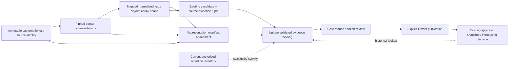

# ADR-013 — Verifiable source evidence and location mapping

Date: 2026-10-18. Owner: Architecture + Product + Security. **Specified — Pending Architecture/Product/Security Review (D-AUD-05)**. No approving identity/date, parser deployment, storage integration or product readiness is claimed. Preserves seven-feature scope, human publication, ADR-010/011/012, Artifact2.0, proposed import-control2.1, Gateway1.0 and Prisma. No OCR, crawl, monitoring or new public evidence endpoint.

## Source-to-consumer audit matrix

Pre-change inspection: actual root decision/audit/provenance/retention/security/scope; Brand Brain/Import PRDs; Ingestion/Processing/Extraction/KM; domain/model/Artifact/database/API and ADR-012; all existing Artifact/import/Gateway schemas and Prisma. Latest versions include Task18's proposed controls. The table records gaps before editing, not invented runtime defects.

| Source → consumer | Existing fields / authority | Gap / specified reconciliation |
| --- | --- | --- |
| Upload/web → Ingestion | RAW_INTAKE.source sourceId/type/originalFilenameOrUrl; data.rawContentReference objectKey/sha256/byteLength/mimeType | Define exact retained bytes and capture identity. URL/filename is display metadata, never immutable version identity |
| Ingestion → Processing | Document.id/correlation/sourceType/latestArtifactId, actual raw Artifact reference | Preserve raw identity and explicit decode/parser/version lineage; latestArtifactId cannot select historical evidence |
| Reader/Cleaner/Normalizer → Chunker | cleanText, processingMetadata.pipelineVersion, structure offsets, chunk sourceOffset/characterCount | Units/maps absent; Normalizer claims date/currency/number/phone/URL normalization. Restrict to documented formatting, never silent interpretation |
| Chunker → Extraction | Immutable chunkId/parentDocumentId, sourceLocation nullable with page/heading/section/chunk/range/coordinateSpace | Original/normalized label alone does not prove a representation, unit, digest, quote or reproducible anchor |
| Extraction → KM | Typed sourceEvidence {sourceArtifactId,sourceDocumentId,sourceLocation,locationUnavailableReason}; original candidate IDs | Preserve tuple; attach a unique versioned validated mapping binding before eligibility. Unsupported precision remains unavailable |
| KM → approved history | Imported field evidence arrays and valueRevisionId, decision original candidate refs; full snapshots/revisions | Resolve immutable introducing decision → original candidate → binding/manifest. Never attach a newer mapping to an old fact silently |
| Review/history → source read | Tenant/source checks, protected object references, independent retention | Recheck current authorization and actual retained representation; a historical verification receipt is not perpetual inspectability |
| Import controls → review/closure | Frozen candidate refs and selected governance; reviewed closure pending D-AUD-07/D-IMP-LC-01 | Evidence validation precedes policy_engine and REVIEW_OPENED. Sidecars are reference dependencies, not new aggregate states/events; stale repairs cannot reopen CLOSED |

## Principles and ownership

Original identity is immutable; parsed/normalized text is a different representation. Verification means reproducibility against identified retained bytes/text under pinned transformation versions, not source honesty or fact truth. Missing/ambiguous mapping is explicit; a normalized offset is never an original offset. Evidence availability, extraction confidence, human approval and factual accuracy are four independent concepts. Confidence policy remains D-AUD-03.

Ingestion owns bounded capture/digest and restricted URL acquisition. Processing owns deterministic decode/parser/transform/chunk manifests and mappings, never business interpretation or approval. Extraction proposes supported facts and literal evidence references; it cannot invent anchors/quotes/typed meaning or become approved. KM validates references, mapping/support policy and current lifecycle before eligibility and again at publication; only Owner decisions publish. A shared internal evidence validator may be reused without circular module dependencies: KnowledgeImportModule coordinates Processing/Extraction/KM; parsers/validators never invoke Extraction/LLM or perform network fetches. Context Engine consumes approved facts, not raw source/evidence as instructions.

## Representations and exact digests

| Representation | Identity, parent and version | Bytes/digest and coordinates | Retention / integrity |
| --- | --- | --- | --- |
| Source identity | Existing sourceId + Document + RAW_INTAKE + organization/Brand; one capture/upload UUID | Identity is not the digest or URL; identical bytes in two tenants remain independent | Keep protected identity and capture metadata while referenced, subject to lawful redaction policy |
| Source content | New immutable representation UUID, parent=null, kind SOURCE | Uploaded exact bytes. Web: exact bounded HTTP content-decoded entity-body bytes **before charset decoding**, not wire compression, DOM serialization or live URL. SHA256 over those exact stored bytes; byteLength verified | Private immutable object key/version; no public bucket; compare digest on every verification read |
| Parsed text | Representation UUID, parent source, kind PARSED, parser/decoder ID+version/config digest | Strict decoded Unicode scalar text serialized as UTF8 with no implicit NFC/newline/BOM change. Digest that exact byte sequence; parser page/text-unit/element/section anchors separately pinned | Source link plus parser version/config and retained text; parsing does not prove PDF reading order or HTML visibility |
| Normalized text | New UUID, parent parsed/prior text, kind NORMALIZED, transform ID/version/config digest | Exact UTF8 bytes after declared transformations. Canonical map offsets in Unicode scalar code points | Keep map and parent identities; missing source bytes reduces live original verification |
| Chunk text | Existing chunkId linked to new kind CHUNK representation UUID and selected normalized parent | Exact chunk text UTF8 digest, logical code-point bounds; merging may reference disjoint source spans | Stable immutable chunk identity; no reusing old ID for different text/parser output |
| Extraction evidence | Stable evidence UUID in one immutable candidate binding, original candidate Artifact/item and source tuple hash | Typed locators into exact representations, optional exact literal excerpts; support LITERAL/INTERPRETED/UNRESOLVED | No model-controlled URLs, coordinates or approving actors. Binding references manifest, not duplicate fact values |
| Approved field provenance | Existing field evidence + introducing revision/decision → candidate/binding | Same historical source identities; verification classification at validation time plus current availability read overlay | Retain referenced identity/maps/allowed content; lawful content deletion does not make old verified receipt live evidence |

Hash algorithm is SHA256, lowercase hex. Text digest is SHA256(UTF8(exact string)), no JSON quotes, Unicode normalization, newline conversion or BOM insertion/removal. Binary digest is SHA256(exact bytes). Reject invalid Unicode scalar sequences (including lone UTF16 surrogates), replacement decoding without explicit parser failure/mapping downgrade, and digest/byte-length mismatch. Manifest/binding IDs are server UUIDs; version/config records are immutable. Digests demonstrate consistency, not publisher identity, authenticity or truth. Do not expose hashes as cross-tenant dedup/existence oracles.

Before validation, SOURCE identity/digest/key/byteLength must agree with the actual authorized RAW_INTAKE receipt; a manifest cannot substitute another retained object. Capture metadata is delivered from the trusted Ingestion capture receipt through durable accepted work under ADR-010 until the final manifest commits; source metadata is private work data, never telemetry. Recovery must replay that captured receipt, not refetch and invent an old capture timestamp. Actual durable capture/queue integration is a D-EVID-01/D-ARCH-01 runtime gate. Capture metadata pins requested/final URL, each validated redirect/status, capture timestamp, response MIME/charset, stored-body convention and capture implementation version. Store sensitive URL/query metadata privately, never in telemetry. Redirect validation follows SEC-T02 at every connection; no refetch occurs during verification. Changed bytes from a subsequent user-triggered import get a new capture/source identity and Document lineage, even at the same URL. No website monitoring is implied.

## Canonical typed locations and coordinates

[Source-evidence1.0.0](../contracts/source-evidence/README.md) is the canonical JSON Schema package. Each location discriminates `kind` and carries digest-pinned representation refs; no free-form location dictionary. Multiple locators remain a list of independent spans/anchors, not a fabricated contiguous range.

| Kind | Required verification / limits |
| --- | --- |
| TEXT_SPAN | Representation ID/digest, start inclusive/end exclusive, UTF8_BYTE or UNICODE_CODE_POINT unit. Verify bounds, boundaries and exact quote if provided. Parsed text spans identify parsed text, not raw binary source coordinates |
| PDF_PAGE_SPAN | Exact SOURCE PDF ID/digest, one-based physical page index (not printed page label), page-text span/unit anchor, parser ID/version/config; page membership and text-unit association must reproduce. Optional bbox only from verified parser coordinates, never estimated by model |
| HTML_ELEMENT_OR_TEXT_SPAN | Immutable captured HTML SOURCE ID/digest, parsed text span and pinned parser; optional captured element ID from retained inert DOM/text-unit map. Optional display URL must match capture metadata, no live selector/refetch |
| STRUCTURAL_SECTION | Representation ID/digest and actual captured heading/section/text-unit ID; no invented character precision or model-generated section IDs |
| NORMALIZED_ONLY | Verified NORMALIZED/CHUNK representation span plus typed originalUnavailableReason. No original page/offset claim |
| UNAVAILABLE | Known source representation ID/digest and typed reason, no coordinates or placeholder quote; missing identity is an integrity error, not a location kind |

All intervals are half-open [start,end), nonempty for evidence. Canonical map spans use **Unicode scalar code points**, never grapheme clusters or JavaScript UTF16 indexes. UTF8_BYTE is allowed only over a UTF8 representation and must end/start on valid sequence boundaries. A byte span over compressed PDF bytes is not a text span. Convert from parser-native units explicitly; reject ambiguous historical units. For JS use Array.from(text) for code-point indexing and Buffer.byteLength(prefix,'utf8') for bytes; a surrogate index into an emoji is invalid. Combining marks count separately before normalization; a composed character can map to a complete multi-code-point source cluster. Persian/Arabic/bidirectional text uses logical stored order; visual reordering is not coordinate order. Escape or visibly label bidi controls in review without altering stored evidence. Grapheme and display selections require explicit UI-to-code-point conversion.

PDF bbox uses PDF_POINTS_CROP_TOP_LEFT, finite x/y/width/height within parser-verified cropped page dimensions, with positive width/height; rendering must verify crop/rotation conversion. Otherwise bbox=null. No pixel claims. Page-text unit ID/page membership/parser must be retained; headers/footers/tables/multiple columns remain separate text units with recorded order. Ambiguous combined reading order downgrades to independently verified units/structural page anchor or unavailable; never quote a synthetic inter-column sentence as one original span. Scanned/image-only pages without enabled OCR are UNAVAILABLE/NO_TEXT_LAYER; no OCR added to MVP. DOCX/Markdown use verified text/structural units, never renderer-dependent fabricated pages.

HTML parser operates on captured bytes in an isolated inert configuration, not a browser/live DOM. Exclude script/style/template and configured hidden attributes; record selection rules/config. Without executing CSS/JS, do not guarantee actual rendered visibility: mark visibility uncertainty, exclude ambiguous hidden/active content from factual extraction or require correction. Entity decoding/DOM text concatenation retains maps to captured text nodes/byte ranges where provable. An XPath/CSS selector alone is not stable across captures. Captured element IDs bind to capture digest + parser + deterministic tree path/text-unit ordinal. Sanitized DOM is a separate representation; never claim its offsets are offsets into original HTML.

## Transformation map strategy

Maps form an acyclic directed lineage graph. Each segment identifies an output code-point interval and zero/one/multiple **ordered** input spans, relation EXACT, TRANSFORMED or GAP. Segments partition the output without overlap/omission; deleted input is recorded as omitted input, never implicitly joined. EXACT supports affine clipping only when text and lengths match; TRANSFORMED maps only the whole declared unit, with no interpolated fine precision. GAP has no input spans and cannot prove original location. Input order can differ from source order only if reordering is explicitly recorded; retain separate source spans and an ambiguity flag. No map can upgrade unknown fidelity into exactness.

| Transformation | Classification / safe behavior |
| --- | --- |
| CRLF→LF / known encoding decode | Span-trackable; full source newline/encoding unit maps to output unit; reversible only with original bytes/map retained |
| Whitespace collapse | Span-trackable for whole run; no proportional offset interpolation |
| Unicode NFC | Span-trackable at complete normalization clusters, not per UTF16 character; retain original literal. NFKC not automatic due semantic risk |
| Character removal | Partially trackable; mark deleted range/gap; split remaining support spans, do not stretch a single range over removed text |
| HTML entity decode | Trackable for whole entity with retained capture/node-byte map; `&amp;` source quote is not literal `&` bytes |
| HTML sanitize/DOM extraction | Partially trackable; excluded/hidden/active regions remain omitted. Reordered/ambiguous joins cannot gain exact original offsets |
| PDF text extraction | Parser-unit/page trackable where actually supplied; byte-to-glyph mapping often unavailable. Reading-order ambiguity remains explicit |
| Sentence/chunk split | EXACT slices where parent text matches; do not change text or infer offsets from token counts |
| Chunk merge/overlap removal | Ordered list of original spans, deduplicating only verified overlap; multiple disjoint supports remain multiple ranges |
| Reordering | Partially trackable independent spans; no single contiguous quote or invented original order |
| Language-dependent punctuation/diacritic/transliteration changes | Disabled by default; if explicitly configured, lossy/unmappable unless an exact tested map exists. Never remove Persian/Arabic meaning-bearing marks as generic noise |

Composition: trace an output interval through each pinned transform to parent spans, clipping only EXACT equal-length segments. Whole TRANSFORMED units retain coarse parent units; partial-unit queries mark finer mapping unavailable. Preserve disjoint intervals/order and gaps at every step. Validate each edge's digests, parser/config, lengths and anchor membership, detect cycles and cap depth/bytes/spans under D-SEC-01. If any edge is missing/lossy, retain last verified representation/structural anchor and emit NORMALIZED_ONLY or UNAVAILABLE; never fill gaps by string search that picks an arbitrary duplicate. Repeated identical text is ambiguous without deterministic anchored identity. Determinism requires pinned parser/package/config/encoding rules, not a fabricated guarantee that different parser versions agree.

## Semantic interpretation is not text normalization

Cleaner/Normalizer may change declared formatting with maps, never silently change currency/date/number/phone/URL meaning. `$149` remains literal `$149`, currency unresolved without actual supporting country/currency evidence. `01/02/2026` stays literal unless an explicit supported locale resolves it; ambiguous dates are not ISO dates. No exchange conversion, price rounding, decimal/grouping guess, phone-country insertion or URL query/path canonicalization that alters identity. URL syntax normalization for SSRF validation is separate from preserving the original source literal/capture display metadata.

Binding support records literal excerpts separately from interpretation status LITERAL/INTERPRETED/UNRESOLVED and ambiguity reasons; it does not copy approved fact values or change ontology/confidence formulas. An inferred currency/date/country or AI paraphrase is not an exact quotation. Unsupported/inferred business meaning must be corrected/reviewed as an explicit manual change under existing provenance, or left unresolved; it cannot become a verified imported literal. Automatic derived inference remains outside approved MVP behavior. Human approval records accountability, not objective truth.

## Evidence classifications and eligibility

Before eligibility, validate current tenant/Brand/source Artifact and Document, original candidate key, selected attempt, exact source tuple, representation/content digests, location kinds/units/bounds/quotes, transform chain, anchor membership and parser/capture/config versions. Model-returned citations are untrusted proposals. KM creates server-validated binding; Extraction cannot assert validation outcome. Recheck source availability/authorization and immutable binding uniqueness before publication.

| Classification | Meaning | Review policy (specified, pending named reviews) |
| --- | --- | --- |
| VERIFIED_EXACT | Claimed individual retained text spans/quotes and original mapping reproduce; PDF/HTML additionally reproduce parent capture/page/unit | Review allowed, never automatically approved; source truth still unproven |
| VERIFIED_STRUCTURAL | Actual page/section/unit is verifiable, finer exact text mapping not claimed | Review allowed with precision label; no fabricated offsets/quote |
| NORMALIZED_ONLY | Normalized/chunk span verifies; original precision unavailable | Review warning; retained source identity and safe support required, no original-page claim |
| UNAVAILABLE | Identity valid, precise mapping/support currently unavailable with typed reason | Do not reject solely for no precise original offsets. Review with warning only if authorized retained source permits human inspection and no false exact quotation/inference is claimed; otherwise correction/manual entry required |
| INVALID | Digest/tenant/reference/offset/quote/map/parser mismatch or fabricated support | Ineligible; safe error, quarantine/repair, no imported publication |

Availability is evaluated per representation now: RETAINED/DELETED/UNKNOWN, separate from the historical classification/validation timestamp. Representation storage availability comes from the authorized storage/lifecycle inventory, not a mutable field in an immutable manifest. Missing original bytes can coexist with a retained verified normalized representation; display exactly what remains reproducible, never say original remains inspectable. A digest without content proves no current excerpt. A new pending candidate whose source/required supporting representation was deleted cannot be approved as imported knowledge without authorized reconstruction/review; approved historical facts retain their prior identity and explicit unavailable warning. Strictness by data category is a reviewed evidence policy (D-EVID-02), not a fabricated confidence threshold or retention period.

## Before and after evidence flow

Before: raw/structured source → normalized chunks with underspecified offsets → loose page/section/range dictionary → approved evidence tuple. The tuple preserves attribution but cannot by itself prove original precision or current inspectability.

After (specified, pending review):

## Minimal versioned Artifact integration

Closed v2 sourceEvidence has no representation/digest/unit/locator/ref/status fields; processingMetadata has no parser/transform map. Do not smuggle JSON into locationUnavailableReason, sourceLocation.sectionId, flags or pipelineVersion. Proposed [Artifact2.2 attachment registry](../contracts/source-evidence/README.md#artifact-extension-and-historical-binding) adds two separately registered JSON variants using existing enums/storage:

1. PROCESSING_INTERMEDIATE/representation_manifest, producer DOCUMENT_PROCESSING, stage evidence_manifest: immutable source representations/maps/chunk membership and capture metadata. Quality Validator atomically persists final v2 STRUCTURED_DOCUMENT and the manifest referencing its preallocated ID; manifest parent=that structured Artifact. It is a reference attachment, not a new pipeline stage/public progress state. Its own invocation prevents checkpoint collisions.
2. KNOWLEDGE_CANDIDATE/evidence_binding, producer KNOWLEDGE_MANAGEMENT, stage evidence_validation: original candidate Artifact/item, exact legacy evidence tuple SHA256, immutable manifest ref/evidence IDs/typed locators/validation receipts. This is the sole evidence binding, not copied facts/approval. Exactly one binding per original candidate key is permitted; all evidence tuple hashes are unique and exactly covered. Different repair requires new candidate/source identity, not a second competing binding or latest-binding selection.

Existing sourceArtifactId remains the actual STRUCTURED_DOCUMENT, sourceDocumentId the actual Document. Candidate legacy evidence tuple hashes use stable-json-v1/SHA256 over the exact existing four-field sourceEvidence DTO; no stringified hidden extension. Original locations with unknown legacy units are not grandfathered as verified. The unique binding is reached by candidate Artifact/item, not an invented v2 evidenceRef. For approved imported fields: introducing valueRevisionId → immutable revision/snapshot parent candidate_decision → original candidateArtifactId/candidateId → unique binding + exact matching legacy evidence hash. Copied unchanged facts preserve introducing valueRevisionId. Restore follows restoredFromRevisionId/fact history to the original importing decision; if lineage cannot unambiguously resolve, mark historical evidence unavailable, never choose a later mapping. Manual/mixed-list provenance resolves per existing introducing/item lineage; no imported evidence is assigned to an unrelated manual value. Bindings and manifests are protected typed JSON references under the existing reference-validation gateway, not a second evidence database. If an edited value changes its evidence tuple, it cannot reuse the old binding by guess: use existing explicit MANUAL provenance for the Owner correction or create a new validated candidate/binding. A changed imported tuple without exact unique coverage blocks publication. This does not invent a bulk repair/approval workflow.

KM validates/persists binding and governance eligibility transactionally before final policy_engine output. Reference attachments are loaded/validated as dependencies of selected structured/candidate/governance records; they are **not** passed to ADR-012's aggregate state resolver as pipeline/control events. REVIEW_OPENED and CLOSED already freeze original candidate keys and governance; immutable unique binding cannot later change that set. Proposed2.1 files/behavior remain unchanged. Partial required-model extraction still cannot open review; valid evidence fragments do not make a failed extraction complete. Parser retry gets new representation/manifest and candidate IDs under authorized selected attempts; stale manifests/bindings never attach to the frozen old candidate or reopen CLOSED. Late repair is rejected; a new authorized workflow/revision is required.

## Retention, privacy and compatibility

All source/map/excerpt reads reauthorize tenant/Brand/source, including historical records and conditional caches. Private immutable object versions or exact Artifact JSON pointers back representations; arbitrary URLs are never content references. Prevent model-directed fetch, active PDF/HTML execution, cross-tenant dedup and digest oracles. Quote rendering is inert/escaped, bounded, and handles bidi controls safely. Logs contain IDs/classifications/reason codes, not excerpts, bytes, maps with content, full URLs or hashes enabling public correlation. D-SEC-01 selects/tests actual parser/capture libraries and budgets; D-SEC-02 governs any external disclosure; no new provider path.

D-POL-01 controls raw/parsed/normalized/map/quote/backup retention independently, with no new periods invented. Source identity survives only as authorized protected metadata after lawful byte deletion/redaction; immutable receipts do not override privacy policy. Deletion scans current/historical evidence and bindings/maps, coordinates locks with reference writers and preserves approved fact identity or requires reviewed tombstones/repair. Orphan/mismatched pointers block new publication/restore and alert; never erase approved knowledge by recursive correlation/parent deletion. Conversation purge preserves independently imported provenance; backups expire separately and restore replays deletion before access. Another retained representation supports only its own exact bytes, not a claim the deleted original is still inspectable. Locators.quote and support.literalTexts are retained **content copies** with their own policy, not harmless identity metadata. If lawful erasure includes excerpts, coordinate redaction/tombstones and access denial for those copies, parsed/chunk text and caches; an immutable JSON receipt cannot bypass erasure. A permitted saved excerpt may be labeled retained excerpt only, never proof the full original remains reproducible. Approved fact retention remains independently reviewed under D-POL-01.

[Contract rollout](../contracts/source-evidence/README.md#compatibility-and-rollout) requires D-EVID-01 version amendment review, readers before writers, explicit legacy unknowns/quarantine, reference/retention and actual parser tests. No old artifacts, controls, Gateway or Prisma files are rewritten. No schema migration is necessary for existing JSON storage; queue/reference/index implementation remains reviewed work. Rollback disables new evidence writes/publication paths, retains both readers and historical bindings, never rewinds approved history or fabricates old maps. D-AUD-03/06/07, D-IMP-LC-01, D-AUD-08 and existing policy/security gates remain open.

## Acceptance and remaining review

[AT-19-01–26 and results](../validation/TASK19_RESULTS.md) use synthetic byte/text/parser-anchor/storage fixtures, not real PDF/DOM parsers, rendering, PostgreSQL or end-to-end proof. D-AUD-05 Specification Delivery means a reviewable typed representation/location/map/policy/compatibility design with executed fixtures; not formal approval or runtime readiness.

D-EVID-01: Architecture/Engineering + source/KM owners review Artifact2.2 attachments, uniqueness/reference lookup, historical lineage and rollout. D-EVID-02: Product/Architecture/Security review evidence warning/correction policy and actual format verification capability; Legal/Operations retain deletion/retention responsibility under D-POL-01. Runtime work: parser/version selection, capture/entity/DOM/PDF anchor adapters, immutable object/digest gateway, bounded map composition, unique binding transactions, eligibility/publication/reference/retention checks, authorized review presentation and crash/stale/hostile-format tests. No Founder scope decision is changed.
