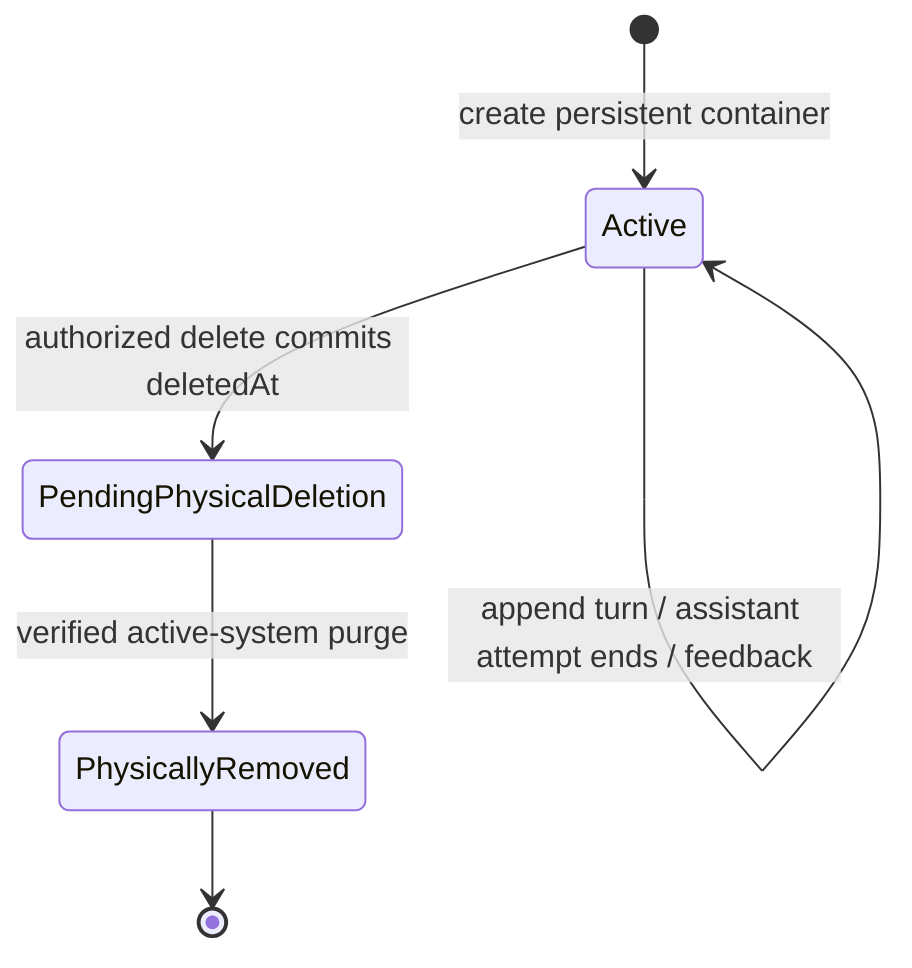
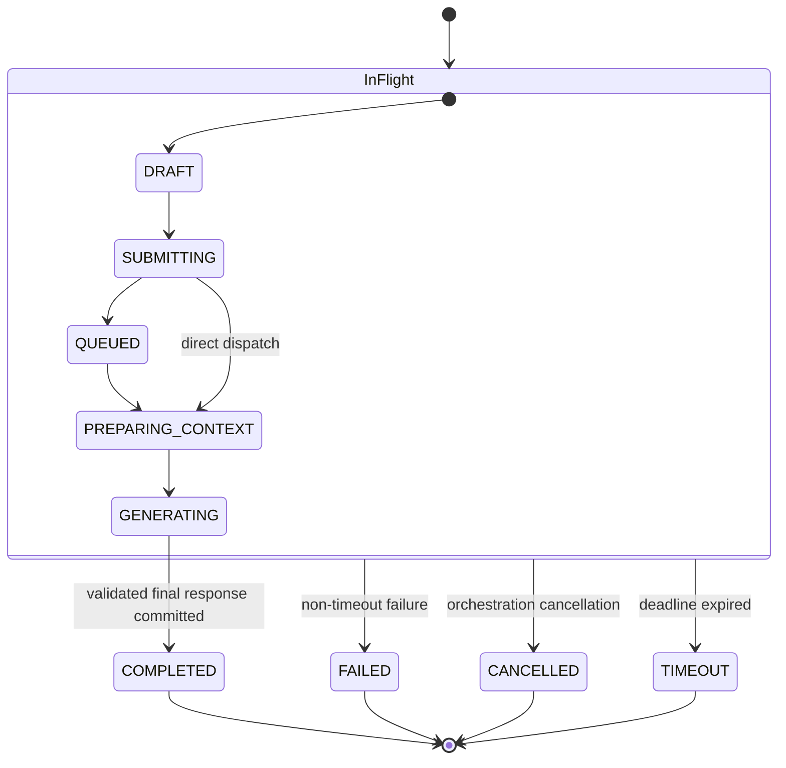

# PRD — AI Workspace

> Final audit (2026-10-16): D-AUD-01 tracks multi-turn history inclusion/window/truncation; no implemented Memory Service or implicit conversation learning is established. D-AUD-08 tracks stream recovery and metric presentation transport. Current Context Visibility remains unchanged pending D-GTM-02. See [final-audit decisions](../DECISION_REGISTER.md#final-audit-decisions) for options and ownership.

> Scope authority (2026-10-13): [MVP_SCOPE.md](../MVP_SCOPE.md). This document specifies intended behavior; design approval does not establish implementation. Historical decisions and long-term concepts do not expand MVP.

Document: **02_AI_WORKSPACE_PRD.md**

Version

1.2.0 — integrated working revision

Status

Draft — Pending Engineering Review (D-REV-02; integrated dependency and release gates disclosed)

Owner

Product

Priority

P0

Last Updated: 2026-10-13 (audit date; historical baseline records retained)

---

# Purpose

AI Workspace is the primary interface through which users interact with AI Brand OS.

It is not merely a chat interface.

It is the operational workspace where users collaborate with an AI that understands their business through the Brand Brain.

Every interaction inside the workspace must be context-aware and leverage the shared intelligence layer.

---

# Problem Statement

Current AI tools require users to repeatedly explain their business, products, audience, tone of voice, and objectives.

This repetitive process wastes time, reduces output quality, and prevents AI from accumulating organizational understanding.

Businesses need a workspace where AI starts every interaction with relevant business context instead of a blank slate.

---

# Goals

The AI Workspace must enable users to:

- Interact naturally with AI.
- Generate business-aware content.
- Reuse organizational knowledge automatically.
- Build trust through consistent outputs.
- Improve AI understanding over time.

---

# Non-Goals

The MVP AI Workspace will not include:

- Multi-user collaboration
- Workflow automation
- AI agents
- Publishing
- Scheduling
- Analytics
- Prompt marketplace
- Plugin ecosystem

These capabilities belong to future releases.

---

# Primary Users

## Marketing Freelancer

Needs fast, context-aware content creation. MVP serves one client Brand; a multiple-client portfolio is Phase 2.

---

## Small Business Owner

Needs marketing assistance without repeatedly explaining the business.

---

## Marketing Team — Phase 2 persona

Needs consistent AI outputs across team members; shared access is excluded from MVP.

---

# User Story

As a business owner,

I want AI to understand my company before answering,

so I receive accurate, consistent, and business-specific responses without rewriting the same context every time.

---

# Core Value Proposition

Traditional AI starts with a prompt.

AI Brand OS starts with business understanding.

---

# Success Criteria

The AI Workspace succeeds when users:

- Complete onboarding successfully.
- Reach first usable presented approved-grounded output under proposed TTFV goals median ≤10 minutes and p90 ≤15 minutes (PRODUCT_METRICS.md; not observed).
- Receive noticeably context-aware responses.
- Prefer AI Brand OS over generic AI tools for business tasks.
- Return frequently because the system improves over time.

---

# Core Responsibilities

The AI Workspace is responsible for:

- User interaction
- Conversation management
- AI request orchestration
- Context visualization (future)
- Output presentation
- User feedback collection

It is not responsible for:

- Knowledge extraction
- Knowledge validation
- Context construction
- Long-term memory

Those responsibilities belong to the Core Domain.

---

# Dependencies

The AI Workspace depends on:

- Brand Brain
- Knowledge Engine (integrated import UX decisions D-IMP-01/02/03 remain pending; see DECISION_REGISTER.md)
  ├── Ingestion Service
  ├── Document Processing Service
  ├── Knowledge Extraction Service
  └── Knowledge Management Service
- Context Engine
- Authentication
- Organizations
- Memory Service

Without these services, the workspace cannot operate correctly.

---

# Out of Scope

The workspace should never contain business logic related to:

- Knowledge processing
- AI model selection strategy
- Data ingestion
- Organization management
- Billing

Its role is orchestration and interaction.

---

# MVP Definition

The Workspace supports context-aware chat and content drafts, conversation history and deletion, response copying, and helpful/not-helpful feedback. These implement canonical features MVP-05 and MVP-06. Approved Brand Brief copying belongs to Brand Brain (MVP-07). File exports are Phase 2.

---

# User Journey

The AI Workspace is designed around a simple principle:

The user should think about their business problem, not about prompting AI.

Every interaction should feel like collaborating with a knowledgeable teammate.

---

# Primary User Journey

The MVP user journey consists of six stages.

```
Login
    ↓
Load sole Organization
    ↓
Load sole Brand
    ↓
Open AI Workspace
    ↓
Ask AI
    ↓
Receive Context-Aware Response
```

If Brand Brain is incomplete, show mandatory missing fields/readiness reasons and retain useful setup/review/history plus a visibly partial approved Brief. New business-aware generation remains unavailable until mandatory approvals are satisfied, regardless of score.

---

# Workspace Layout

The MVP interface consists of four primary areas.

```
------------------------------------------------------
| Header                                             |
|----------------------------------------------------|
| Sidebar | Conversation Area           | Inspector  |
|         |                             | (Future)   |
|         |                             |            |
|----------------------------------------------------|
| Prompt Input                                      |
------------------------------------------------------
```

### Header

Responsibilities:

- User menu
- Settings
- New conversation

---

### Sidebar

Responsibilities:

- Static Organization label (top); dropdown switching is Phase 2 — see `design/01_COMPONENT_KIT.md`
- Section divider separating org-level from brand-scoped navigation
- Brand-scoped navigation: Brand Brain, AI Workspace, Settings; dedicated Knowledge Base placement is proposed pending [D-IMP-03](../DECISION_REGISTER.md#d-imp-03)
- Conversation history (nested under AI Workspace)
- Search conversations (Future)
- Pin conversation (Future)
- Delete conversation

In Phase 2, switching Organization is a full context reset, not a partial state update — the active Brand, brand-scoped navigation, and conversation history all belong to the previous Organization and are discarded.

---

### Conversation Area

Responsibilities:

- Display messages
- Stream AI responses
- Render markdown
- Show citations (Future)
- Copy response

---

### Prompt Input

Responsibilities:

- User prompt
- Attach document (Future)
- Suggested actions (Future)
- Submit request

The input should remain minimal during the MVP.

---

# Conversation Lifecycle

A Conversation is a persisted multi-turn container scoped to one Organization and Brand. It is created before its first accepted turn, can hold many user/assistant Messages, and remains Active after any individual generation finishes, fails, times out or is cancelled. There is no Conversation-level COMPLETED/GENERATING/FAILED enum or terminal “Conversation Saved” state. Each accepted turn/history change is persisted during normal operation; feedback is optional and never a prerequisite for saving.



Active means the row is not pending deletion, not that all requests are allowed. Brand archival or failed business readiness can make an existing Active container read-only for new generation; these are access conditions, not generation terminal states. Normal reads still enforce tenant and deletion checks. PendingPhysicalDeletion denies all normal content access and has no MVP restore transition. Purge retries/holds remain pending; backup expiry is separate from active-system removal, per [DATA_LIFECYCLE.md](../DATA_LIFECYCLE.md).

A turn’s workflow is request acceptance → context preparation → model generation → durable response, with streaming as a transport effect. MessageStatus tracks that individual assistant attempt; it does not change the Conversation lifecycle. The Workspace delegates context construction to Context Engine. See [State Management](#state-management) for the exact enum and transitions.

---

# Workspace States

## Empty State

Displayed when no conversation exists.

Purpose:

Guide users toward their first interaction.

Suggested actions:

- Ask a question
- Generate content
- Explore example prompts

---

## Active Conversation

Displays:

- User messages
- AI responses
- Streaming tokens
- Copy action

---

## Loading State

Displayed while:

- Context is being prepared
- AI response is generated

Requirements:

- Immediate visual feedback
- Streaming when available
- Prevent duplicate submissions

---

## Error State

Possible failures:

- Network error
- AI provider unavailable
- Context retrieval failure
- Rate limit exceeded
- Unknown error

Every error should provide:

- Human-readable explanation
- Retry option
- Error identifier for debugging

---

# Interaction Principles

The Workspace should feel:

- Fast
- Predictable
- Minimal
- Context-aware
- Trustworthy

Users should never need to understand internal AI architecture.

---

# AI Request Flow

The Workspace submits only three pieces of information.

```
Conversation

+

User Request

+

Current Brand
```

Everything else is retrieved automatically through the Core Domain.

---

# Context Visibility

For the current specified MVP, retrieved context remains hidden. Task 15’s proposed limited deliverable claim/source review would amend this UX only after D-GTM-02 and Product/Engineering review; raw internal prompts/context artifacts remain hidden. See [GTM workflow and benchmark](../GO_TO_MARKET_STRATEGY.md).

Future versions may introduce:

- Context Inspector
- Source Viewer
- Retrieved Knowledge Preview
- Confidence Score

These are intentionally excluded from the MVP.

---

# Conversation History

Every conversation stores:

- User messages
- AI responses
- Timestamps
- Associated Brand
- Conversation title
- Feedback state

Conversation history must never replace Brand Brain.

It is operational history, not organizational knowledge.

---

# Feedback Loop

Each AI response supports lightweight feedback.

Initial MVP actions:

- 👍 Helpful
- 👎 Not Helpful

Future releases may include:

- Edit response
- Explain answer
- Save to Brand Brain
- Improve response

MVP feedback is stored against the response for product analysis; it does not create knowledge candidates, approve facts, infer preferences or train a model. Automatic interaction-to-candidate generation is a later-phase proposal. An Owner can separately correct Brand Brain through its existing edit/review flow. See [knowledge learning lifecycle](../KNOWLEDGE_LEARNING_LIFECYCLE.md).

---

# Accessibility

Minimum MVP requirements:

- Full keyboard navigation
- Screen reader compatibility
- High contrast support
- Responsive layout
- Mobile usability

Accessibility is considered a core product quality requirement.

---

# Functional Requirements

## FR-001 — Open AI Workspace

### Description

The authenticated user can open the AI Workspace after loading the account’s sole Organization and Brand.

### Preconditions

- User is authenticated.
- Organization exists.
- Brand exists.
- User has access to the selected Brand.

### Acceptance Criteria

- Workspace loads successfully.
- Current Organization is displayed.
- Current Brand is displayed.
- Conversation list is loaded.
- Prompt input is enabled only when effective Brand Brain business readiness and runtime request gates pass; show missing mandatory fields/readiness reasons separately from completeness score. See KNOWLEDGE_PROVENANCE.md.

---

## FR-002 — Create New Conversation

### Description

The user can start a new conversation.

### Acceptance Criteria

- A new conversation is created.
- Conversation becomes active.
- Input receives focus automatically.
- Previous conversations remain accessible.

---

## FR-003 — Send Prompt

### Description

The user submits a natural language request.

### Validation Rules

- Prompt cannot be empty.
- Prompt length must be within configured limits.
- Prompt must belong to the active Brand.

### Acceptance Criteria

- Request is accepted.
- Loading state appears immediately.
- Duplicate submission is prevented.
- Request is forwarded to the Context Engine.

---

## FR-004 — Generate AI Response

### Description

The Workspace requests an AI response using business-aware context.

### Acceptance Criteria

- Context is retrieved automatically.
- Response begins streaming as soon as available.
- Markdown is rendered correctly.
- Response is attached to its assistant Message in the current Conversation; durable validation/response linkage and COMPLETED commit together. The parent remains Active and can accept later turns when request gates pass.

The Workspace must never build context itself.

---

## FR-005 — Conversation Persistence

### Description

Every conversation is automatically saved.

### Acceptance Criteria

Persist:

- Messages
- Timestamps
- Brand
- Organization
- Conversation metadata

No manual save action is required.

---

## FR-006 — Conversation History

### Description

Users can access previous conversations.

### Acceptance Criteria

- Conversations are ordered by latest activity.
- Selecting a conversation restores its messages.
- History loads incrementally.
- Deleted conversations are removed from the list; direct and nested API access is also denied immediately, even before physical purge.

---

## FR-007 — Delete Conversation

### Description

The authorized Owner may confirm deletion of a Conversation. Deletion immediately denies normal access and requests physical removal; it does not report completed erasure. The canonical design and proposed policy are [DATA_LIFECYCLE.md](../DATA_LIFECYCLE.md).

### Acceptance Criteria

- Require confirmation and server-side tenant/Owner authorization; unknown or unauthorized IDs return a non-disclosing 404.
- Atomically set deletedAt and create one durable purge request; return 204 after commit. Repeat authorized DELETE is idempotent while the request/receipt exists, preserving the original deadline.
- Immediately deny list/detail/nested message and artifact access, feedback, generation, retrieval, operational memory, and applicable export/download access. Stop streams and reject late generation writes under transaction serialization.
- deletedAt means pending physical deletion. No MVP restore/undo is exposed.
- A purge removes Messages, conversation-specific Feedback, owned generation artifacts (including context/prompt/response/error/retry payloads), working memory/caches/indexes and exported files if applicable. It preserves independent imported/approved Brand Brain knowledge and other workflows’ shared artifacts.
- Proposed target: permanent removal from active systems within 30 days of deletedAt, requiring legal and operational approval. Backups expire separately; no immediate backup erasure is promised.
- Failed/blocked purges remain inaccessible, retry idempotently, and alert Operations; approved exceptions are narrowly scoped and reviewed. Completion requires verified resource absence, not just parent row deletion.
- Validate the scenarios in DATA_LIFECYCLE.md before claiming implementation completion.

---

## FR-008 — Copy Response

### Description

Users can copy any AI response.

### Acceptance Criteria

- Plain text is copied.
- Markdown formatting is preserved when supported.
- Success feedback is displayed.

---

## FR-010 — Feedback

### Description

Users can rate AI responses.

### MVP Actions

- Helpful
- Not Helpful

Acceptance Criteria

- Feedback is stored.
- Duplicate voting is prevented.
- Feedback is linked to the response.

---

# Business Rules

## BR-001

Every Workspace session belongs to exactly one Organization.

---

## BR-002

Every conversation belongs to exactly one Brand.

---

## BR-003

Every AI request must pass through the Context Engine.

---

## BR-004

Every AI request must be executed through the AI Orchestrator.

---

## BR-005

The Workspace never accesses Brand Brain directly.

---

## BR-006

The Workspace never modifies Brand Brain.

Only the Knowledge Engine may update business knowledge.

---

## BR-007

Conversation History is not organizational knowledge.

Conversation History and Brand Brain are independent domains. Conversation deletion removes owned copies of retrieved knowledge in generation payloads, but never deletes source Documents, approved knowledge, provenance or another workflow’s artifacts. Shared dependency checks and failed purge behavior are defined in [DATA_LIFECYCLE.md](../DATA_LIFECYCLE.md).

---

# Edge Cases

## EC-001

User sends an empty prompt.

Expected Result

Validation error.

---

## EC-002

Network disconnects while streaming.

Expected Result

Partial streamed text is shown as incomplete until final status is recovered. Network disconnect alone does not change MessageStatus. Reconnect/read the same attempt; a stored completed response is recovered from history. A new retry is available only after a terminal failure/cancellation/timeout and creates a new assistant attempt, preserving the previous one.

---

## EC-003

LLM provider timeout.

Expected Result

The assistant attempt transitions to TIMEOUT on the configured deadline and shows a recoverable error. Its Conversation remains Active/intact; an allowed retry is a new attempt under the same container.

---

## EC-004

Context Engine returns no context.

Expected Result

Show an explicit recoverable context limitation and preserve the draft prompt; do not quietly answer without approved context or count it as brand-grounded first value. Direct the Owner to setup/approved knowledge and a visibly partial approved Brief where available. No new context-aware generation bypasses readiness.

---

## EC-005

Brand archived during conversation.

Expected Result

Conversation becomes read-only.

User sees that the sole Brand is archived; new generation is unavailable until that Brand is restored through Brand Brain. Selecting another Brand is Phase 2.

(Revised 2026-07-02: "archived," not "deleted" — Brand has no hard-delete
path. See `01_DOMAIN_MODEL.md` Brand Lifecycle, added this session.)

---

## EC-006

User loses permissions.

Expected Result

Workspace closes.

Unauthorized message is displayed.

---

# Non-Functional Requirements

The Workspace must:

- Feel responsive.
- Support streaming responses.
- Recover gracefully from failures.
- Minimize waiting time.
- Scale to large conversation histories.
- Remain AI-provider agnostic.

---

# Security Requirements

The Workspace must never expose:

- Internal prompts
- Raw internal context artifacts (authorized approved facts may appear in generated responses)
- API keys
- Provider credentials
- Internal system instructions

All authorization checks must be enforced server-side.

---

# Domain Model

The AI Workspace manages interaction, not business knowledge.

Core Entities (persisted in this domain):

- Conversation
- Message
- Feedback

The following are explicitly NOT separate AI Workspace entities, despite
earlier drafts of this document listing them. They are fully modeled in
`02_ARTIFACT_MODEL.md` and referenced from Message, not duplicated here
(see `domain/04_DATABASE_DESIGN.md` ADR-003 and ADR-004 for the full
reasoning):

- ~~Workspace Session~~ — no FR or AC in this document ever reads/writes
  one; the required state (current User + Organization + Brand) lives in
  the authenticated session, not a persisted aggregate.
- ~~AI Request~~ — maps to Prompt Context Artifact + Prompt Artifact.
- ~~AI Response~~ — maps to Response Artifact.

The following entities belong to other domains and are referenced only by
ID:

- Organization
- Brand
- Brand Brain
- User

---

# Entity Relationships

Conversation

↓

Messages (1:N)

Each assistant generation attempt carries a `correlationId`. A COMPLETED assistant Message must have a durable
`responseArtifactId`; pending or failed attempts may have no response. This points into the Artifact Model's pipeline
(`Prompt Context Artifact → Prompt Artifact → Response Artifact`) for full
execution detail (tokens, cost, latency, model, validation).

Message

↓

Feedback (0:1)

A Conversation always belongs to exactly one Brand.

A Brand may contain many Conversations.

---

# API Boundaries

The Workspace is an orchestration layer.

It communicates only through public application services.

Allowed integrations:

- Authentication Service
- Organization Service
- Conversation Service
- Context Engine
- AI Orchestrator
- Memory Service

Direct database access to Brand Brain is prohibited.

---

# State Management

The authoritative generation enum is MessageStatus in [schema.prisma](../schema.prisma); the scope is an **individual assistant Message generation attempt**. Its parent Conversation is the persistent multi-turn container defined in [Conversation Lifecycle](#conversation-lifecycle). Database Design ADR-008 records this separation. Documentation reconciliation is fixed; runtime implementation still requires verification.

## Message (generation) states

| MessageStatus | Meaning / entry condition |
| --- | --- |
| DRAFT | Assistant placeholder allocated for an accepted, tenant-authorized valid request, before dispatch. This is not a Conversation state or a user’s unsent composer draft. |
| SUBMITTING | Dispatch/acceptance of this attempt is underway. |
| QUEUED | Accepted attempt waits for execution; optional if dispatched synchronously. No new queue infrastructure is implied by this enum. |
| PREPARING_CONTEXT | Retrieve and validate the pinned approved Brand Brain context for this attempt. |
| GENERATING | Build/execute prompt, stream provisional tokens and validate result; provider retries within the attempt stay here under the configured deadline. |
| COMPLETED | Final validated response is durably stored/linked to this assistant Message; terminal for this attempt only, not proof of presentation/first value. |
| FAILED | Non-timeout validation/context/provider/execution failure after attempt allocation; terminal for this attempt only. |
| CANCELLED | Trusted orchestration cancels a nonterminal attempt; terminal for this attempt only. This does not declare a new public cancel feature. |
| TIMEOUT | Configured attempt deadline expires while nonterminal; terminal for this attempt only. Performance goals are not timeout settings. |



Normal transitions: DRAFT→SUBMITTING→QUEUED→PREPARING_CONTEXT→GENERATING→COMPLETED; direct dispatch may skip QUEUED. Every nonterminal state may transition to FAILED, CANCELLED or TIMEOUT with the corresponding reason. No terminal state returns to an in-progress state. These transitions are per attempt, not per Conversation.

USER Messages are stored directly as COMPLETED after request validation, without traversing this assistant state machine. ASSISTANT creation must explicitly set DRAFT; the schema’s COMPLETED default is for accepted USER messages and must not accidentally finish an assistant placeholder. Invalid requests rejected before allocation do not invent a failed persisted generation.

Use atomic expected-state transitions with Conversation deletedAt checks, so late success/error callbacks cannot overwrite a terminal result or publish deleted content. Durable response/responseArtifactId and COMPLETED are committed together. A transport disconnect alone does not prove generation failure: recover status/history for the same attempt; if it completed, return the stored response. If still active, reconnect/read its status rather than allocate a duplicate retry. If FAILED/CANCELLED/TIMEOUT, an explicit retry creates a new assistant Message ID and correlationId in the same Conversation, retaining the prior terminal attempt and safe retry lineage in artifact metadata. The old attempt never resets. Public cancellation endpoints and concrete deadlines/retry budgets remain open engineering/product decisions; the enum does not prove their implementation.

## Conversation states

There is no ConversationStatus generation column. Active is derived from a persisted row with deletedAt=null; PendingPhysicalDeletion from deletedAt≠null; PhysicallyRemoved is verified removal, not a row status. ConversationPurge.status is an independent cleanup-job/receipt lifecycle (PENDING/RUNNING/RETRY_REQUIRED/BLOCKED/EXCEPTION/COMPLETED), not MessageStatus or a public Conversation restore state.

A completed assistant response leaves the Conversation Active. The Owner can submit a second and subsequent turn with the same Conversation ID when readiness, authorization and runtime gates pass. Feedback, response copying and user input drafts do not mutate the prior MessageStatus or terminate its parent. Archived Brand/readiness failure preserves permitted history but blocks new generation; deletion denies history too.

Deleting a Conversation requests cancellation of active attempts and suppresses late writes/streams. Any cancellation metadata transition must occur in the deletion transaction or narrowly authorized internal cleanup path; normal generation callbacks cannot write content after the tombstone. Physical purge may remove Messages regardless of their last status once the approved deletion inventory/safeguards are satisfied. Proposed purge/backup targets remain subject to approval under DATA_LIFECYCLE.md; a purge job’s COMPLETED never means a Message generation completed or a backup was immediately erased.

## Lifecycle acceptance scenarios

- Complete assistant attempt A, then submit turn B under the same Conversation ID: A stays COMPLETED, B gets a new assistant Message, and the container remains Active.
- Fail, cancel or time out A: only A is terminal; allowed retry creates B, and previous history remains intact.
- Disconnect during streaming: do not infer FAILED from transport alone; recover/reconnect the same attempt, and never create a duplicate active generation on a retry click.
- Race terminal success with a late error/retry callback: expected-state checks preserve the first committed terminal outcome.
- Delete during PREPARING_CONTEXT or GENERATING: tombstone denies normal access and late publication; purge bookkeeping does not resurrect the Conversation.
- Complete USER submission: its stored MessageStatus is COMPLETED immediately, while its assistant attempt explicitly starts DRAFT.
- Complete generation before UI presentation: status is COMPLETED, but QualifiedFirstValue still waits for PRODUCT_METRICS.md output-presentation/grounding checks.

These are acceptance specifications, not executed application tests.

---

# Events

The Workspace emits domain events.

Examples:

ConversationCreated

PromptSubmitted

ContextRequested

GenerationStarted

GenerationCompleted

GenerationFailed

ConversationDeletionRequested (tombstone committed)

ConversationPurgeCompleted (verified active-system removal; not backup erasure)

FeedbackSubmitted

These events enable future analytics and automation without coupling the Workspace to downstream services.

---

# Permissions

MVP exposes only the sole Owner’s access to their Organization, Brand, and conversations. Tenant and ownership checks are required server-side. Admin, Editor, Viewer, Reviewer, Guest, shared access, and invitations are Phase 2; retained role enum values are future compatibility, not MVP capabilities.

---

# Telemetry

The Workspace should capture content-minimized pseudonymous product events for improvement.

Examples:

- Workspace Opened
- Conversation Created
- Prompt Submitted
- Response Generated
- Feedback Submitted
- Error Encountered
- AI Request Completed
- AI Request Failed

Telemetry must never include sensitive business content.

---

# Performance Requirements

Target metrics for MVP:

Workspace Initial Load

≤ 2 seconds

Conversation Switch

≤ 300 ms

Streaming Start

≤ 2 seconds

Average AI Response

≤ 10 seconds

Conversation Save

≤ 500 ms

Context Retrieval

≤ 1 second

Performance targets should be monitored continuously.

---

# Error Handling

All recoverable failures should:

- preserve user input
- preserve conversation history
- display meaningful messages
- allow retry

Unexpected failures should generate server-side diagnostics.

---

# Future Extensibility

The Workspace architecture must support future capabilities without redesign.

Examples:

- Context Inspector
- Prompt Library
- AI Personas
- Automated multi-step workflows (basic multi-turn Conversations are already MVP)
- Artifact Generation
- AI Agents
- Voice Interaction
- Multi-modal Inputs

These features are intentionally excluded from the MVP.

---

# MVP Checklist

The AI Workspace MVP is complete when users can:

- Authenticate.
- Load the sole owned Organization.
- Load the sole Brand.
- Open the Workspace.
- Start a conversation.
- Receive context-aware AI responses.
- View conversation history.
- Delete conversations with immediate access denial and durable physical-purge tracking (FR-007).
- Provide response feedback.
- Copy an AI response.

Nothing else is required for MVP validation.

---

# Definition of Done

The AI Workspace is considered complete when:

- All functional requirements are implemented.
- Acceptance criteria pass.
- Accessibility requirements are satisfied.
- Security review is complete.
- Performance targets are met.
- Documentation is updated.
- Engineering review is approved.
- Product review is approved.

Implementation alone does not constitute completion.

---

# Open Questions

The following topics are intentionally deferred until after MVP validation:

- Conversation search
- Conversation folders
- Shared conversations
- Prompt templates
- Context transparency
- AI reasoning visualization
- Multi-brand conversations
- Offline support

These items require customer validation before implementation.

---

# Related Documents

[BIBLE/01_PROJECT_BIBLE.md](../BIBLE/01_PROJECT_BIBLE.md)

[BIBLE/02_PRODUCT_BIBLE.md](../BIBLE/02_PRODUCT_BIBLE.md)

[BIBLE/03_ENGINEERING_BIBLE.md](../BIBLE/03_ENGINEERING_BIBLE.md)

[BIBLE/04_EXECUTION_BIBLE.md](../BIBLE/04_EXECUTION_BIBLE.md)

[prd/01_BRAND_BRAIN_PRD.md](01_BRAND_BRAIN_PRD.md)

[prd/03_KNOWLEDGE_IMPORT_PRD.md](03_KNOWLEDGE_IMPORT_PRD.md)

[services/01_INGESTION_SERVICE.md](../services/01_INGESTION_SERVICE.md)

[services/02_DOCUMENT_PROCESSING_SERVICE.md](../services/02_DOCUMENT_PROCESSING_SERVICE.md)

[services/03_KNOWLEDGE_EXTRACTION_SERVICE.md](../services/03_KNOWLEDGE_EXTRACTION_SERVICE.md)

[services/04_KNOWLEDGE_MANAGEMENT_SERVICE.md](../services/04_KNOWLEDGE_MANAGEMENT_SERVICE.md)

[services/05_CONTEXT_ENGINE.md](../services/05_CONTEXT_ENGINE.md)

[services/06_AI_ORCHESTRATOR.md](../services/06_AI_ORCHESTRATOR.md)

[domain/02_ARTIFACT_MODEL.md](../domain/02_ARTIFACT_MODEL.md)

[domain/04_DATABASE_DESIGN.md](../domain/04_DATABASE_DESIGN.md)

[domain/05_API_DESIGN.md](../domain/05_API_DESIGN.md)

design/01_COMPONENT_KIT.md

---

# Version History

## Version 1.0.0

Initial production-ready PRD for the AI Workspace.

Defines:

- Product scope
- User journeys
- Functional requirements
- Business rules
- Technical boundaries
- Domain events
- Performance targets
- Definition of Done

## Version 1.1.0

- Removed WorkspaceSession, AIRequest, AIResponse as AI Workspace-owned
  entities — corrected to reference Artifact Model directly, per
  `domain/04_DATABASE_DESIGN.md` ADR-003 / ADR-004.
- Permissions section rewritten to use the canonical Engineering Bible
  role set (Owner/Admin/Editor/Viewer) instead of a locally-defined
  Member role. Viewer promoted from Future to MVP.
- EC-005 corrected: "Brand deleted" → "Brand archived", aligned to new
  Brand Lifecycle in `01_DOMAIN_MODEL.md`.

## Version 1.1.1

- Status markers reconciled: single `Approved for Engineering Design`
  status; removed the two stray mid-document `Status: Draft` blocks and
  the leftover `01_AI_WORKSPACE.md` title alias.
- State Management corrected to two distinct lifecycles — per-Message
  generation states + the historical Conversation soft-delete label (Active → Deleted; now PendingPhysicalDeletion, not completed erasure) — per
  `domain/04_DATABASE_DESIGN.md` ADR-006.
- Related Documents updated to current canonical filenames/paths.

## Version 1.1.2

- Organization selector and Brand selector moved from Header to Sidebar,
  per the Component Kit v1.0.0 Organization Switcher spec
  (`design/01_COMPONENT_KIT.md`, 2026-07-15). Reason: multi-org navigation
  needs to be visually separated from brand-scoped actions; a Header
  holding both org-level and brand-level controls conflated the two.
- Sidebar Responsibilities restructured: Organization Switcher at top,
  section divider, then brand-scoped navigation (Brand Brain, Knowledge
  Base, AI Workspace, Settings), with conversation history nested under
  AI Workspace.
- Recorded that switching Organization is a full context reset, not a
  partial state update.

---

# Status

Draft — Pending Engineering Review (D-REV-02; integrated dependency and release gates disclosed)

Version

1.2.0 — integrated working revision

Effective Working-Revision Date

2026-10-13 (not an approval date)

---

## Output qualification and incomplete Brand Brain

[PRODUCT_METRICS.md](../PRODUCT_METRICS.md) governs OutputPresented/QualifiedFirstValue and optional copy/helpful quality signals. Generation submission/completion/first token do not imply value before a usable validated grounded output is presented. Business readiness requires all mandatory approved facts; completeness ≥70 cannot bypass it. Incomplete users retain setup/review/approved history and partial approved Brief copying with visible limitations; ungrounded generic chat is not an MVP readiness workaround.

---

## Approval scope and blocking/release decision ownership

Historical baseline approval/correction records remain cited as [D-WS-01](../DECISION_REGISTER.md#preserved-evidence-based-decisions-and-remaining-review-ownership); current whole-revision engineering sign-off is pending D-REV-02. The integrated import journey must not inherit Founder approval from a dependency’s stale label: D-IMP-01/02/03 await Founder disposition. DATA_LIFECYCLE.md policy intervals require Legal/Operations/Product approval (D-POL-01), separately from architecture choices. Cancellation/deadline implementation choices are Engineering/Product-owned, not invented Founder questions. Deferred post-MVP search/folders/shared-conversation topics do not block the approved historical baseline.

---

# END OF DOCUMENT


# Task 10 — Security acceptance and release dependency

[SECURITY_THREAT_MODEL.md](../SECURITY_THREAT_MODEL.md) is the shared security contract. SEC-01–06 and the applicable SEC-AT-01–08 scenarios are mandatory launch gates, pending implementation evidence and Security review; this addition grants no PRD sign-off. Every mutation and artifact/retrieval operation requires server-side tenant/Owner authorization. Imported and retrieved material is data, never policy authority; AI extraction and automated eligibility cannot approve knowledge. Candidate review access is distinct from generation eligibility.

Import UI limits are advisory: the server enforces scan/quarantine, type/size and fetch/redirect protections. A blocked source returns a safe reason and manual-entry fallback without leaking internal destinations or malware payloads. Generation uses only approved tenant-scoped knowledge and reviewed provider processing, with safe response rendering and no automatic external image/link loading. The full assembled system prompt, credentials and internal context artifact are not exposed through debug UI; authorized business facts may appear in useful responses and the approved Brand Brief. Context hiding is a UX choice, not a security boundary or a promise that approved facts can never appear in responses.

Acceptance mapping: import → SEC-AT-01/02/03/04/07; Brand Brain review/edit/restore → SEC-AT-04/05/07/08; Workspace generation/history/feedback/copy/deletion → SEC-AT-01/04/06/08. Provider disclosures, finite operational budgets and storage/retention readiness remain D-SEC-01/02/03 in the [decision register](../DECISION_REGISTER.md). Tests listed here are specifications, not executed results.


# Task 14 — Strategic interpretation and scope boundary

[COMPETITIVE_STRATEGY.md](../COMPETITIVE_STRATEGY.md) proposes evidence-backed business knowledge as positioning, not a unique or delivered advantage. [DIFFERENTIATION_ROADMAP.md](../DIFFERENTIATION_ROADMAP.md) maps A/B/C to existing commitments and new later proposals. Existing field provenance, explicit Owner approval, approved revision/context and copyable Brief requirements remain; no automatic monitoring, full knowledge export, connected API/MCP, delegated review or multi-brand capability is added to this PRD. Numeric comparative benefit targets are proposed experiments, not this revision’s performance guarantees or observed results. D-COMP-01/02 and existing PRD/scope/security gates remain pending.


# Task 15 — Proposed deliverable evidence/claim review, pending approval

[GO_TO_MARKET_STRATEGY.md](../GO_TO_MARKET_STRATEGY.md) step6 proposes a limited material-claim→approved-fact/source mapping with revision/as-of identity and unsupported/conflicting/unknown-verification warnings. This is not already committed Source Viewer/Context Inspector functionality and does not change current MVP scope by implication. D-GTM-02 requires Product/Architecture/Security review of mapping completeness, uncertainty labels, tenant-authorized source access, safe rendering and acceptance tests before delivery claims or paid offers include it. If demonstrated manually, label prototype/assisted rather than automated. No claim of comprehensive semantic detection or guaranteed truth is allowed. The proposed blinded native-project comparison gives both arms identical evidence and Owner corrections; it is an experiment, not a passing performance result.
